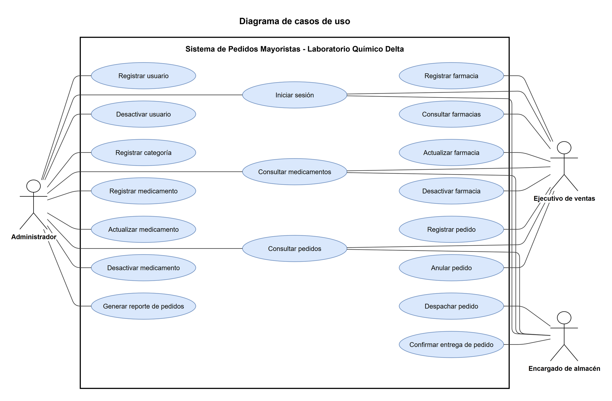

# Modelado UML

Para modelar los requerimientos usamos dos herramientas que se complementan: un diagrama de casos de uso y un conjunto de historias de usuario. El diagrama muestra qué actor usa cada función del sistema, y las historias agregan los criterios de aceptación, es decir, cuándo damos por cumplida cada necesidad. La guía permite presentar ambas cosas, así que repartimos la información entre las dos para no repetirla.

## Diagrama de casos de uso

El rectángulo grande es el límite del sistema y lleva el nombre de la aplicación. Dentro están los dieciocho casos de uso, escritos con un verbo y un objeto, y fuera quedan los tres actores: el Administrador, el Ejecutivo de ventas y el Encargado de almacén. Cada línea une a un actor con un caso de uso que realiza. Iniciar sesión, Consultar medicamentos y Consultar pedidos son los casos que comparten los tres actores, por eso quedan en la columna del centro.

Los casos de uso se agrupan en los módulos que usamos en toda la documentación. Autenticación tiene Iniciar sesión; Usuarios tiene el registro y la desactivación de usuarios; Farmacias cubre el registro, la consulta, la actualización y la desactivación de farmacias; Medicamentos agrupa las categorías y el ciclo de vida de los medicamentos; y Pedidos reúne el registro, la consulta, el despacho, la entrega, la anulación y el reporte. El descuento de stock no tiene un óvalo propio porque ocurre dentro de Despachar pedido: al despachar, el sistema resta del stock las cantidades del pedido.

## Casos de uso y requerimientos

| Código | Caso de uso | Actor(es) | Requerimientos |
| --- | --- | --- | --- |
| CU-01 | Iniciar sesión | Administrador, Ejecutivo de ventas, Encargado de almacén | RF-01, RF-02, RF-03 |
| CU-02 | Registrar usuario | Administrador | RF-04 |
| CU-03 | Desactivar usuario | Administrador | RF-05 |
| CU-04 | Registrar farmacia | Ejecutivo de ventas | RF-06 |
| CU-05 | Consultar farmacias | Ejecutivo de ventas | RF-07, RF-08, RF-11 |
| CU-06 | Actualizar farmacia | Ejecutivo de ventas | RF-09 |
| CU-07 | Desactivar farmacia | Ejecutivo de ventas | RF-10 |
| CU-08 | Registrar categoría | Administrador | RF-12 |
| CU-09 | Registrar medicamento | Administrador | RF-13 |
| CU-10 | Consultar medicamentos | Administrador, Ejecutivo de ventas, Encargado de almacén | RF-14, RF-15 |
| CU-11 | Actualizar medicamento | Administrador | RF-16 |
| CU-12 | Desactivar medicamento | Administrador | RF-17 |
| CU-13 | Registrar pedido | Ejecutivo de ventas | RF-18, RF-19 |
| CU-14 | Consultar pedidos | Administrador, Ejecutivo de ventas, Encargado de almacén | RF-20, RF-21 |
| CU-15 | Despachar pedido | Encargado de almacén | RF-22, RF-23, RF-24 |
| CU-16 | Confirmar entrega de pedido | Encargado de almacén | RF-25 |
| CU-17 | Anular pedido | Ejecutivo de ventas | RF-26 |
| CU-18 | Generar reporte de pedidos | Administrador | RF-27 |

## Historias de usuario

Las catorce historias siguientes cubren los mismos requerimientos desde el punto de vista de quien los usa, con condiciones que se pueden comprobar al probar el sistema.

| Código | Historia de usuario | Criterios de aceptación | Requerimientos |
| --- | --- | --- | --- |
| HU-01 | Como usuario del sistema, quiero iniciar y cerrar sesión con mi correo y mi contraseña, para ver solo las opciones que corresponden a mi rol. | Con credenciales correctas entra al panel principal; con credenciales incorrectas ve un mensaje de error y no entra; al cerrar sesión no puede volver a los módulos sin ingresar otra vez. | RF-01, RF-02, RF-03 |
| HU-02 | Como Administrador, quiero registrar usuarios con su rol y desactivarlos, para controlar quién puede entrar al sistema. | El usuario se guarda con nombre completo, correo, contraseña y rol; el correo no puede repetirse; un usuario desactivado no puede iniciar sesión. | RF-04, RF-05 |
| HU-03 | Como Ejecutivo de ventas, quiero registrar una farmacia, para poder tomarle pedidos. | Se exigen nombre, NIT, teléfono, dirección y zona; el NIT no puede repetirse; la farmacia nueva aparece en el listado de activas. | RF-06 |
| HU-04 | Como Ejecutivo de ventas, quiero ver el listado de farmacias activas, buscar por nombre o NIT y abrir el detalle de una, para encontrar rápido a la farmacia que me llama. | El listado muestra solo farmacias activas; la búsqueda devuelve las que coinciden con el nombre o el NIT; el detalle muestra todos los datos de la farmacia. | RF-07, RF-08, RF-11 |
| HU-05 | Como Ejecutivo de ventas, quiero modificar o desactivar una farmacia, para mantener sus datos al día sin perder su historial. | Los cambios se ven en el detalle; el NIT modificado tampoco puede repetirse; una farmacia desactivada sale del listado de activas pero sus pedidos se conservan. | RF-09, RF-10 |
| HU-06 | Como Administrador, quiero registrar categorías y medicamentos, para mantener el catálogo que se ofrece a las farmacias. | El medicamento exige nombre, presentación, categoría, precio mayorista mayor que cero y stock igual o mayor que cero; el medicamento nuevo aparece en el listado; la categoría se guarda con nombre y descripción. | RF-12, RF-13 |
| HU-07 | Como Administrador, quiero modificar o desactivar un medicamento, para corregir precios y retirar los que ya no se venden. | El nuevo precio se muestra en el listado y no puede ser cero ni negativo; un medicamento desactivado sale del listado de activos; los pedidos anteriores que lo incluyen se conservan. | RF-16, RF-17 |
| HU-08 | Como Encargado de almacén, quiero ver los medicamentos con su stock y abrir el detalle de uno, para saber qué hay disponible antes de preparar un pedido. | El listado muestra categoría, precio mayorista y stock de cada medicamento activo; el detalle muestra todos sus datos. | RF-14, RF-15 |
| HU-09 | Como Ejecutivo de ventas, quiero registrar un pedido con varios medicamentos para una farmacia, para que el almacén sepa exactamente qué preparar. | Solo se puede elegir una farmacia activa; el pedido necesita al menos un medicamento y cada cantidad es mayor que cero; el sistema calcula subtotales y total; el pedido queda en estado pendiente. | RF-18, RF-19 |
| HU-10 | Como Ejecutivo de ventas o Encargado de almacén, quiero listar los pedidos por estado o por farmacia y abrir uno, para saber en qué punto está cada pedido. | El filtro por estado muestra solo los pedidos de ese estado; el filtro por farmacia muestra solo los de esa farmacia; el detalle muestra medicamentos, cantidades, precios y total. | RF-20, RF-21 |
| HU-11 | Como Ejecutivo de ventas, quiero anular un pedido que todavía está pendiente, para corregir un pedido tomado por error. | Un pedido pendiente pasa a anulado; un pedido despachado o entregado no se puede anular; el stock no cambia. | RF-26 |
| HU-12 | Como Encargado de almacén, quiero marcar un pedido pendiente como despachado, para que el stock refleje lo que salió del almacén. | Solo se despachan pedidos pendientes; al despachar baja el stock de cada medicamento en la cantidad pedida; si el stock de alguno no alcanza, el despacho se rechaza y el mensaje indica cuál medicamento falta. | RF-22, RF-23, RF-24 |
| HU-13 | Como Encargado de almacén, quiero marcar un pedido despachado como entregado, para cerrar el ciclo del pedido. | Solo un pedido despachado puede pasar a entregado; el pedido entregado queda en el historial de su farmacia. | RF-25 |
| HU-14 | Como Administrador, quiero generar el reporte de pedidos de una farmacia en un rango de fechas, para revisar lo que ha pedido en un periodo. | El reporte lista solo los pedidos de la farmacia elegida dentro de las fechas indicadas; muestra el estado y el total de cada pedido; si no hay pedidos, lo indica con un mensaje. | RF-27 |
