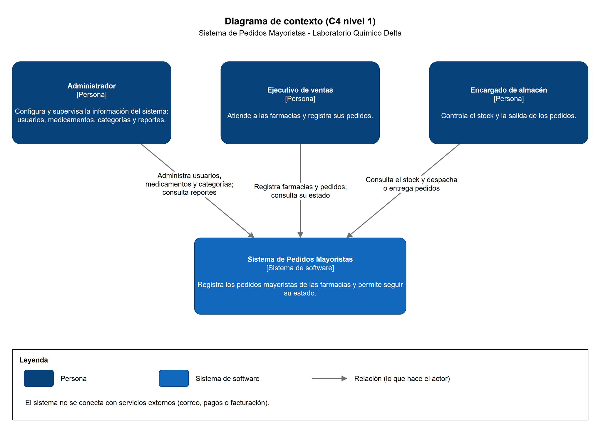
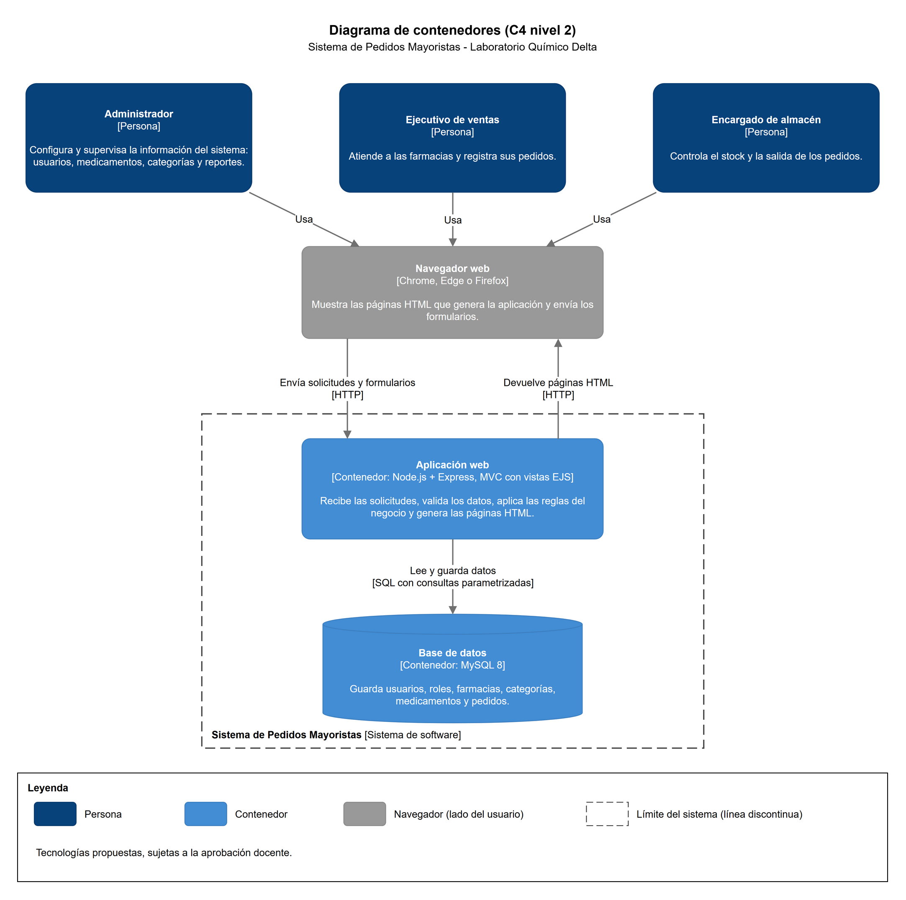
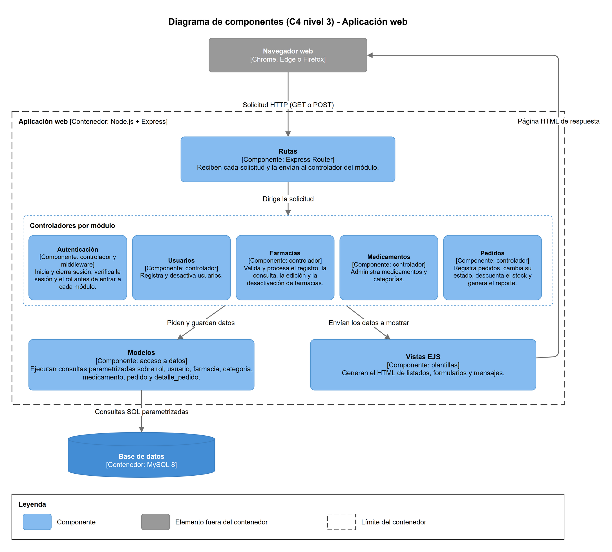

# Modelado C4

El modelo C4 describe una solución desde la vista más general hasta sus partes internas, en niveles que se acercan cada vez más. Aquí presentamos los niveles 1 a 3: el contexto, los contenedores y los componentes. El nivel 4, que baja hasta el código, lo dejamos para la implementación, como permite la guía.

## Nivel 1: diagrama de contexto

El sistema lo usan tres personas, cada una con una función distinta. El Administrador mantiene los usuarios, los medicamentos y las categorías y consulta los reportes; el Ejecutivo de ventas registra farmacias y pedidos y revisa su estado; el Encargado de almacén consulta el stock y despacha o entrega los pedidos. No dibujamos sistemas externos porque el alcance no tiene correo, pagos ni facturación, y no queríamos inventar integraciones que no existen.

## Nivel 2: diagrama de contenedores

Las personas trabajan desde un navegador web, que muestra las páginas y envía los formularios. Del otro lado está la Aplicación web, una sola aplicación Node.js con Express organizada con el patrón MVC, cuyas vistas EJS se generan en el servidor. Por eso no hay un frontend y un backend como proyectos separados: el mismo programa recibe la solicitud, aplica las reglas y devuelve la página ya armada. Para un sistema de este tamaño y un solo desarrollador nos pareció lo más simple de construir y de explicar. El tercer contenedor es la base de datos MySQL 8, donde se guarda toda la información.

La comunicación es sencilla: el navegador y la aplicación se hablan por HTTP, y la aplicación lee y guarda datos con consultas SQL parametrizadas. Un contenedor en C4 es una unidad de software o de almacenamiento que se ejecuta por separado, no un contenedor de Docker. Las tecnologías que aparecen en este nivel son una propuesta y están sujetas a la aprobación docente.

## Nivel 3: diagrama de componentes

Aquí abrimos la Aplicación web. Las Rutas reciben cada solicitud que llega del navegador y la envían al controlador del módulo que corresponde. Antes de entrar a un módulo, el componente de Autenticación comprueba la sesión y el rol del usuario. Cada controlador (Usuarios, Farmacias, Medicamentos y Pedidos) valida los datos y aplica las reglas de su módulo. Los Modelos son los únicos que hablan con la base de datos, siempre con consultas parametrizadas, y las Vistas EJS arman el HTML de listados, formularios y mensajes que vuelve al navegador.

## Arquitectura propuesta

Para ver cómo trabajan juntas las partes, seguimos una operación completa: el registro de una farmacia. El Ejecutivo de ventas abre en el navegador el formulario en la ruta GET /farmacias/nueva, lo llena y lo envía con POST /farmacias. Las Rutas dirigen la solicitud al controlador de Farmacias, después de que Autenticación confirma que hay una sesión iniciada con un rol que puede registrar farmacias. El controlador revisa que lleguen los campos obligatorios (nombre, NIT, teléfono, dirección y zona) y le pasa los datos al modelo de Farmacia, que inserta la fila en la tabla farmacia de MySQL con una consulta parametrizada.

Si el NIT ya existe, la restricción UNIQUE de la base de datos rechaza el registro y el controlador vuelve a mostrar el formulario con un mensaje claro, sin detalles técnicos. Si todo sale bien, redirige a GET /farmacias, donde la vista EJS dibuja el listado de farmacias activas con un mensaje de éxito y la página HTML vuelve al navegador. Despachar un pedido sigue el mismo camino, con la diferencia de que el modelo de Pedidos también descuenta el stock de los medicamentos.

## Coherencia entre los diagramas

Los mismos tres actores aparecen en el análisis, en los casos de uso y en el diagrama de contexto, y la base de datos que dibujamos en C4 es la misma que modelamos en la sección de base de datos. La tabla siguiente relaciona cada módulo con sus casos de uso y con las tablas que usa.

| Módulo | Casos de uso | Tablas que usa |
| --- | --- | --- |
| Autenticación | Iniciar sesión | usuario, rol |
| Usuarios | Registrar usuario, Desactivar usuario | usuario, rol |
| Farmacias | Registrar farmacia, Consultar farmacias, Actualizar farmacia, Desactivar farmacia | farmacia |
| Medicamentos | Registrar categoría, Registrar medicamento, Consultar medicamentos, Actualizar medicamento, Desactivar medicamento | medicamento, categoria |
| Pedidos | Registrar pedido, Consultar pedidos, Despachar pedido, Confirmar entrega de pedido, Anular pedido, Generar reporte de pedidos | pedido, detalle_pedido, medicamento, farmacia |
