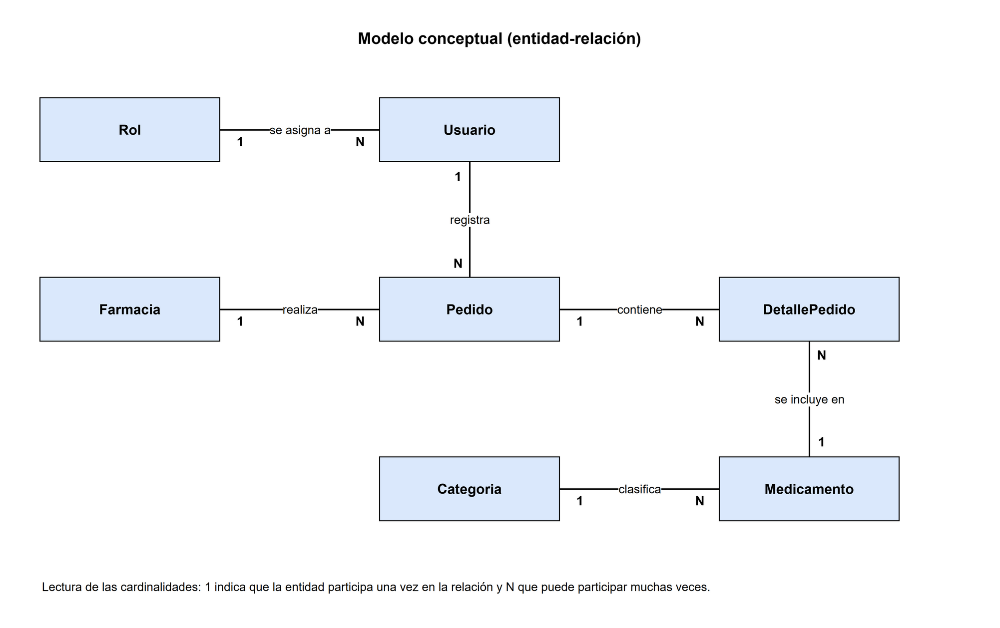
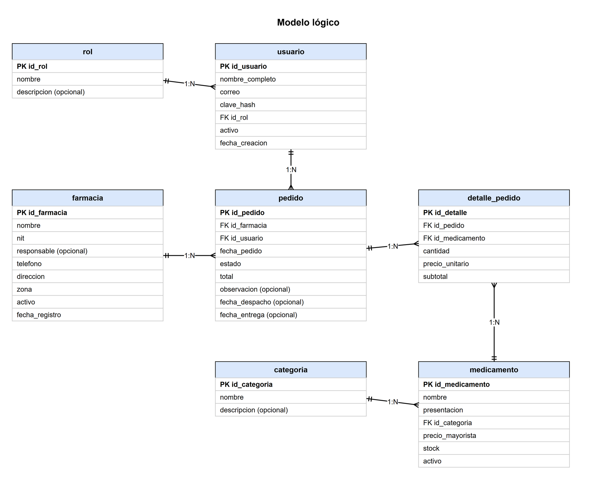
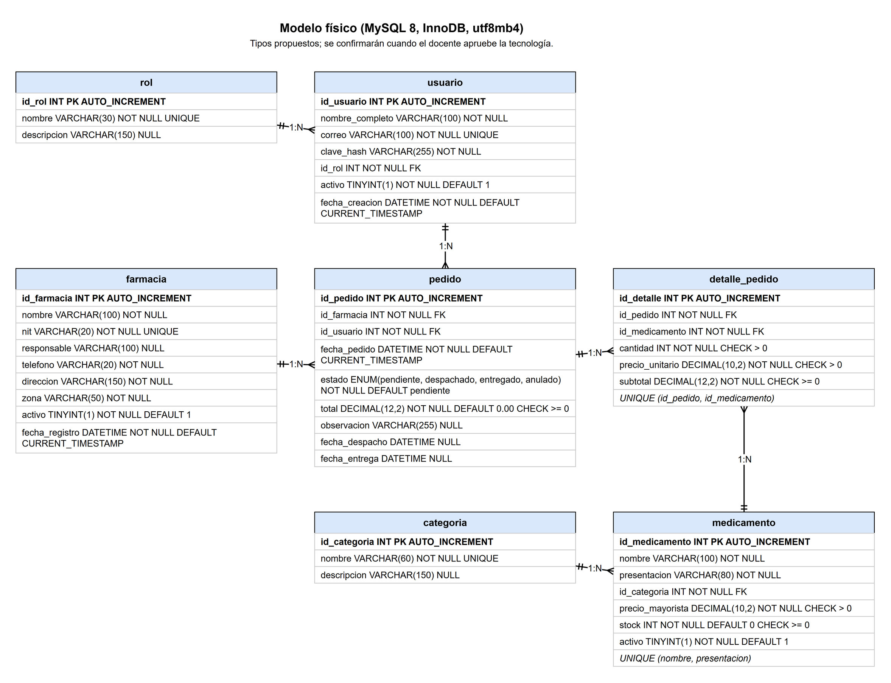

# Base de datos

Para diseñar la base de datos partimos de los sustantivos que aparecen en los requerimientos funcionales: farmacia, medicamento, categoría, pedido, usuario y rol. De ahí salieron las entidades y las presentamos en tres modelos. El conceptual dice qué cosas existen y cómo se relacionan, sin pensar todavía en tablas. El lógico organiza esas cosas en tablas, campos y claves. El físico baja el lógico a un motor concreto, con tipos de dato y restricciones.

## Entidades

| Entidad | Qué información guarda | Ejemplos de atributos |
| --- | --- | --- |
| Rol | Los tipos de usuario que existen en el sistema. | nombre, descripción |
| Usuario | Las personas que entran al sistema y el rol que tienen. | nombre completo, correo, clave, rol, activo |
| Farmacia | Las farmacias clientes del laboratorio. | nombre, NIT, responsable, teléfono, dirección, zona, activo |
| Categoria | Los grupos en que se clasifican los medicamentos. | nombre, descripción |
| Medicamento | El catálogo de medicamentos que se vende al por mayor. | nombre, presentación, categoría, precio mayorista, stock, activo |
| Pedido | Cada pedido que hace una farmacia. | farmacia, usuario que lo registró, fecha, estado, total, observación |
| DetallePedido | Cada línea de un pedido: un medicamento con su cantidad. | pedido, medicamento, cantidad, precio unitario, subtotal |

DetallePedido existe porque un pedido lleva varios medicamentos y un medicamento aparece en muchos pedidos; sin esta entidad habría que repetir columnas dentro de Pedido.

## Modelo conceptual

| Relación | Cardinalidad | Lectura |
| --- | --- | --- |
| Rol se asigna a Usuario | 1 : N | Un rol puede asignarse a muchos usuarios y cada usuario tiene un solo rol. |
| Usuario registra Pedido | 1 : N | Un usuario puede registrar muchos pedidos y cada pedido lo registra un solo usuario. |
| Farmacia realiza Pedido | 1 : N | Una farmacia puede realizar muchos pedidos y cada pedido pertenece a una sola farmacia. |
| Pedido contiene DetallePedido | 1 : N | Un pedido contiene varias líneas y cada línea pertenece a un solo pedido. |
| Medicamento se incluye en DetallePedido | 1 : N | Un medicamento puede aparecer en muchas líneas de pedido y cada línea se refiere a un solo medicamento. |
| Categoria clasifica Medicamento | 1 : N | Una categoría agrupa muchos medicamentos y cada medicamento pertenece a una sola categoría. |

Entre Pedido y Medicamento la relación real es de muchos a muchos, porque un pedido incluye varios medicamentos y un medicamento está en varios pedidos. DetallePedido la resuelve y además guarda el precio que tenía el medicamento al momento del pedido.

## Modelo lógico

| Tabla | Campos principales | Clave / relación |
| --- | --- | --- |
| rol | id_rol, nombre, descripcion | PK id_rol |
| usuario | id_usuario, nombre_completo, correo, clave_hash, id_rol, activo, fecha_creacion | PK id_usuario; FK id_rol a rol |
| farmacia | id_farmacia, nombre, nit, responsable, telefono, direccion, zona, activo, fecha_registro | PK id_farmacia |
| categoria | id_categoria, nombre, descripcion | PK id_categoria |
| medicamento | id_medicamento, nombre, presentacion, id_categoria, precio_mayorista, stock, activo | PK id_medicamento; FK id_categoria a categoria |
| pedido | id_pedido, id_farmacia, id_usuario, fecha_pedido, estado, total, observacion, fecha_despacho, fecha_entrega | PK id_pedido; FK id_farmacia a farmacia; FK id_usuario a usuario |
| detalle_pedido | id_detalle, id_pedido, id_medicamento, cantidad, precio_unitario, subtotal | PK id_detalle; FK id_pedido a pedido; FK id_medicamento a medicamento |

Los campos opcionales son la descripción de rol y categoría, el responsable de la farmacia, la observación del pedido y las fechas de despacho y entrega, que solo se llenan cuando el pedido avanza de estado.

## Revisión del modelo

Revisamos el modelo lógico con las preguntas de la guía. Todas las tablas tienen una clave primaria, y cada clave foránea apunta a una tabla que existe. Un pedido guarda muchos medicamentos a través de detalle_pedido, sin columnas repetidas como medicamento1 o medicamento2. El nombre de la categoría no se repite en la tabla medicamento: allí solo se guarda id_categoria.

El precio unitario se copia a detalle_pedido porque el precio mayorista de un medicamento puede cambiar después, y los pedidos anteriores deben conservar el precio con el que se vendieron. El subtotal y el total los calcula el sistema al registrar el pedido y los guardamos para que las consultas y el reporte sean más simples. Por último, farmacia, medicamento y usuario tienen el campo activo, de modo que se desactivan en lugar de borrarse y el historial de pedidos se conserva (RNF-10).

## Modelo físico

Proponemos MySQL 8 con el motor InnoDB y el juego de caracteres utf8mb4, para que los acentos se guarden bien. Como la tecnología todavía debe aprobarla el docente, los tipos de dato se deben confirmar antes de implementar. Las reglas de integridad que incluimos son: campos obligatorios con NOT NULL, valores únicos en el NIT de la farmacia, el correo del usuario y los nombres de rol y categoría, restricciones CHECK para que el precio mayorista, el precio unitario y la cantidad sean mayores que cero y para que el stock, el subtotal y el total no sean negativos, y las seis claves foráneas entre tablas.

## Diccionario de datos

| Tabla / campo | Tipo propuesto | Regla | Descripción |
| --- | --- | --- | --- |
| rol.id_rol | INT | PK, automático | Identificador del rol. |
| rol.nombre | VARCHAR(30) | Obligatorio, único | Nombre del rol: Administrador, Ejecutivo de ventas o Encargado de almacén. |
| rol.descripcion | VARCHAR(150) | Opcional | Explicación breve de lo que puede hacer el rol. |
| usuario.id_usuario | INT | PK, automático | Identificador del usuario. |
| usuario.nombre_completo | VARCHAR(100) | Obligatorio | Nombre y apellido de la persona que usa el sistema. |
| usuario.correo | VARCHAR(100) | Obligatorio, único | Correo con el que inicia sesión. |
| usuario.clave_hash | VARCHAR(255) | Obligatorio | Contraseña guardada como hash, nunca en texto plano. |
| usuario.id_rol | INT | Obligatorio, FK a rol | Rol asignado al usuario. |
| usuario.activo | TINYINT(1) | Obligatorio, valor por defecto 1 | Indica si el usuario puede entrar (1) o fue desactivado (0). |
| usuario.fecha_creacion | DATETIME | Obligatorio, valor por defecto la fecha actual | Fecha y hora en que se registró el usuario. |
| farmacia.id_farmacia | INT | PK, automático | Identificador de la farmacia. |
| farmacia.nombre | VARCHAR(100) | Obligatorio | Nombre comercial de la farmacia. |
| farmacia.nit | VARCHAR(20) | Obligatorio, único | Número de identificación tributaria de la farmacia. |
| farmacia.responsable | VARCHAR(100) | Opcional | Persona encargada de hacer los pedidos en la farmacia. |
| farmacia.telefono | VARCHAR(20) | Obligatorio | Teléfono de contacto. |
| farmacia.direccion | VARCHAR(150) | Obligatorio | Dirección donde se entregan los pedidos. |
| farmacia.zona | VARCHAR(50) | Obligatorio | Zona de la ciudad en que está la farmacia. |
| farmacia.activo | TINYINT(1) | Obligatorio, valor por defecto 1 | Indica si la farmacia está activa (1) o desactivada (0). |
| farmacia.fecha_registro | DATETIME | Obligatorio, valor por defecto la fecha actual | Fecha y hora en que se registró la farmacia. |
| categoria.id_categoria | INT | PK, automático | Identificador de la categoría. |
| categoria.nombre | VARCHAR(60) | Obligatorio, único | Nombre de la categoría de medicamentos. |
| categoria.descripcion | VARCHAR(150) | Opcional | Descripción breve de la categoría. |
| medicamento.id_medicamento | INT | PK, automático | Identificador del medicamento. |
| medicamento.nombre | VARCHAR(100) | Obligatorio, único junto con presentacion | Nombre del medicamento con su concentración. |
| medicamento.presentacion | VARCHAR(80) | Obligatorio | Forma en que se vende, por ejemplo caja de tabletas. |
| medicamento.id_categoria | INT | Obligatorio, FK a categoria | Categoría a la que pertenece. |
| medicamento.precio_mayorista | DECIMAL(10,2) | Obligatorio, mayor que cero | Precio de venta al por mayor. |
| medicamento.stock | INT | Obligatorio, igual o mayor que cero, valor por defecto 0 | Unidades disponibles en el almacén. |
| medicamento.activo | TINYINT(1) | Obligatorio, valor por defecto 1 | Indica si el medicamento se sigue vendiendo (1) o fue desactivado (0). |
| pedido.id_pedido | INT | PK, automático | Identificador del pedido. |
| pedido.id_farmacia | INT | Obligatorio, FK a farmacia | Farmacia que hizo el pedido. |
| pedido.id_usuario | INT | Obligatorio, FK a usuario | Usuario que registró el pedido. |
| pedido.fecha_pedido | DATETIME | Obligatorio, valor por defecto la fecha actual | Fecha y hora en que se registró el pedido. |
| pedido.estado | ENUM('pendiente','despachado','entregado','anulado') | Obligatorio, valor por defecto pendiente | Estado actual del pedido. |
| pedido.total | DECIMAL(12,2) | Obligatorio, igual o mayor que cero, valor por defecto 0.00 | Suma de los subtotales del pedido, calculada por el sistema. |
| pedido.observacion | VARCHAR(255) | Opcional | Nota libre sobre el pedido. |
| pedido.fecha_despacho | DATETIME | Opcional | Fecha y hora en que el almacén despachó el pedido. |
| pedido.fecha_entrega | DATETIME | Opcional | Fecha y hora en que se confirmó la entrega. |
| detalle_pedido.id_detalle | INT | PK, automático | Identificador de la línea del pedido. |
| detalle_pedido.id_pedido | INT | Obligatorio, FK a pedido, único junto con id_medicamento | Pedido al que pertenece la línea. |
| detalle_pedido.id_medicamento | INT | Obligatorio, FK a medicamento | Medicamento pedido en esa línea. |
| detalle_pedido.cantidad | INT | Obligatorio, mayor que cero | Unidades pedidas. |
| detalle_pedido.precio_unitario | DECIMAL(10,2) | Obligatorio, mayor que cero | Precio mayorista vigente cuando se registró el pedido. |
| detalle_pedido.subtotal | DECIMAL(12,2) | Obligatorio, igual o mayor que cero | Cantidad multiplicada por el precio unitario. |

## Script SQL inicial

El archivo database/script_inicial.sql es un borrador: crea la base de datos delta_pedidos, las siete tablas y algunos datos ficticios de prueba (roles, categorías, medicamentos y farmacias). Lo vamos a ejecutar cuando se instale el servidor MySQL en la siguiente actividad. No crea usuarios del sistema, porque las contraseñas deben guardarse como hash (RNF-02) y todavía no existe esa parte de la aplicación.
