# Prototipo de interfaces

Para revisar la navegación y los campos antes de programar elaboramos un prototipo navegable con páginas HTML y una hoja de estilos común. Elegimos HTML en lugar de Figma porque nos permitía armar las pantallas rápido y, además, reutilizar los mismos estilos en las vistas EJS de la aplicación real. El prototipo está en la carpeta prototipos/ del repositorio y se abre con cualquier navegador desde el archivo index.html. Las pantallas no guardan datos: los nombres, montos y mensajes que aparecen son de ejemplo y sirven solo para mostrar cómo se verá cada función.

Todas las pantallas internas comparten la misma estructura: una barra superior con el nombre del laboratorio y del usuario que inició sesión, un menú lateral con los módulos agrupados (ventas, catálogo y administración) y el área de contenido. Los botones principales van en azul, las acciones de desactivar o anular en rojo y los estados de los pedidos se muestran con etiquetas de color, para que se distingan de un vistazo.

## Pantallas y requerimientos relacionados

| Pantalla | Archivo | Requerimientos |
| --- | --- | --- |
| Inicio de sesión | index.html | RF-01 |
| Panel principal | panel.html | RF-02, RF-03 |
| Listado de farmacias | farmacias.html | RF-07, RF-11 |
| Registro y edición de farmacia | farmacia-form.html | RF-06, RF-09 |
| Detalle de farmacia | farmacia-detalle.html | RF-08 |
| Confirmación para desactivar farmacia | farmacia-desactivar.html | RF-10 |
| Listado de medicamentos | medicamentos.html | RF-14, RF-17 |
| Registro y edición de medicamento | medicamento-form.html | RF-13, RF-16 |
| Detalle de medicamento | medicamento-detalle.html | RF-15 |
| Listado de pedidos | pedidos.html | RF-20, RF-26 |
| Registro de pedido | pedido-nuevo.html | RF-18, RF-19 |
| Detalle de pedido | pedido-detalle.html | RF-21, RF-22, RF-23, RF-24, RF-25 |
| Usuarios | usuarios.html | RF-04, RF-05 |
| Reporte de pedidos por farmacia | reporte.html | RF-27 |
| Registro no encontrado | no-encontrado.html | RNF de mensajes claros |

El registro de categorías (RF-12) no tiene una pantalla propia en esta versión del prototipo, porque las categorías iniciales se cargan con el script de la base de datos; su formulario será igual de sencillo que el de farmacias y se agregará cuando se implemente.

## Mensajes de éxito, validación y error

En el prototipo dejamos marcados los lugares donde aparecerán los mensajes. En el listado de farmacias se ve el mensaje de confirmación después de registrar una farmacia. En los formularios de farmacia y de medicamento se muestran errores de validación debajo de cada campo, por ejemplo un NIT repetido, un teléfono vacío o un precio negativo, además de un aviso general en la parte superior. En el detalle del pedido aparece el error que impide despachar cuando el stock de un medicamento no alcanza, y la pantalla de inicio de sesión muestra el mensaje para credenciales incorrectas.

## Navegación

El recorrido principal empieza en el inicio de sesión, que lleva al panel. Desde el panel y desde el menú lateral se llega a cada módulo. En cada listado, el botón de nuevo registro abre el formulario, y los botones Guardar y Cancelar devuelven al listado. Desde el detalle de una farmacia se puede ir directamente a registrar un pedido para ella, y desde el listado de pedidos se abre el detalle donde el encargado de almacén cambia el estado.

## Capturas del prototipo

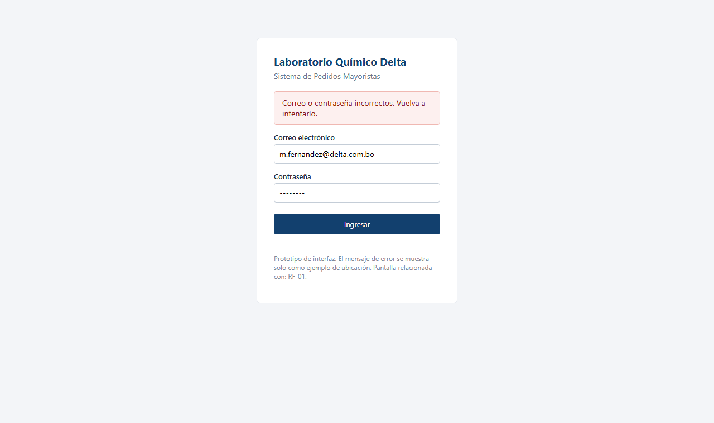

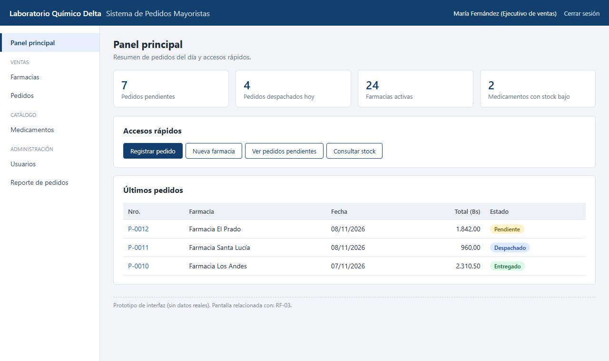

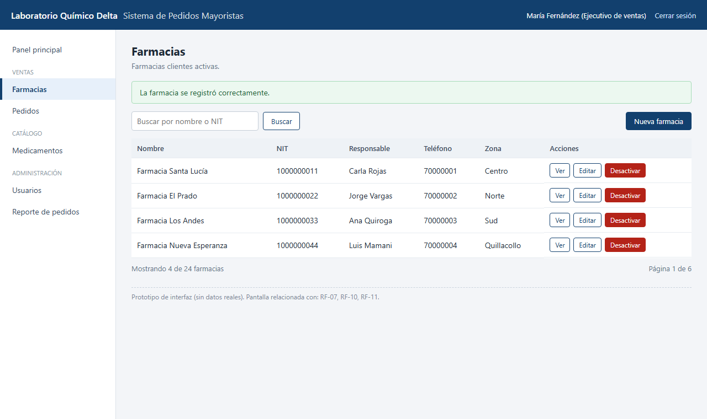

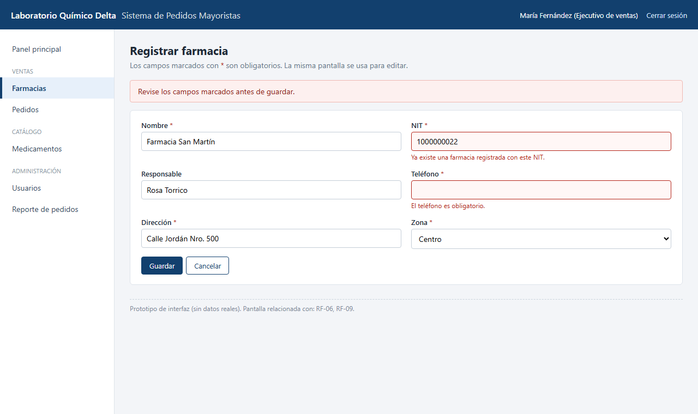

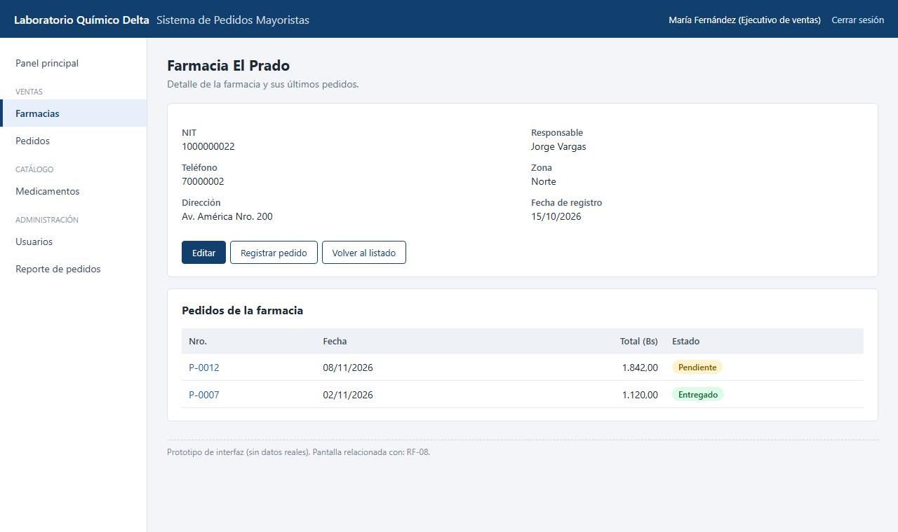

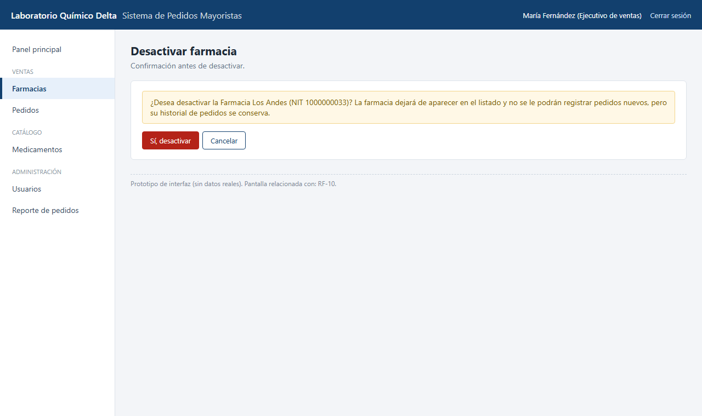

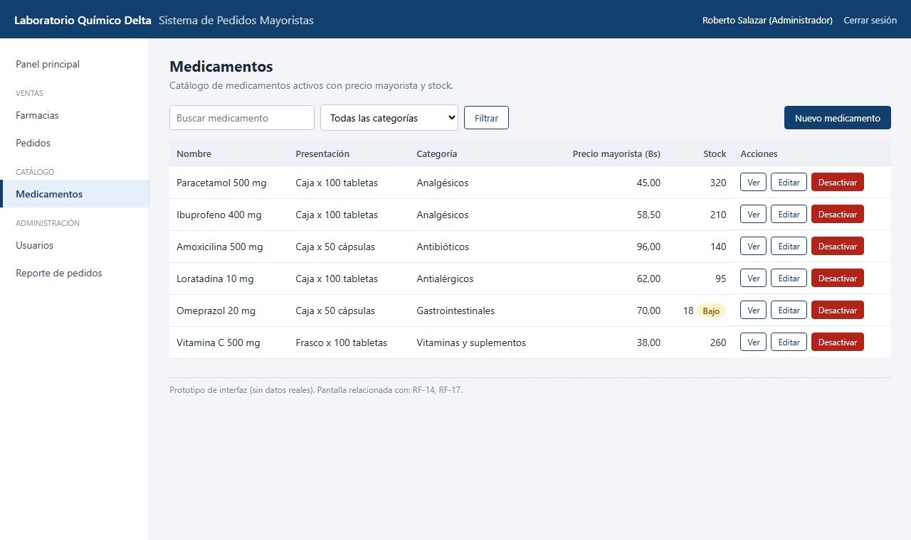

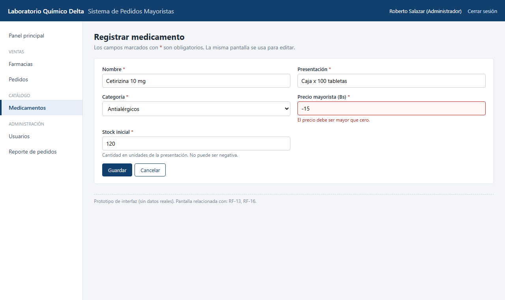

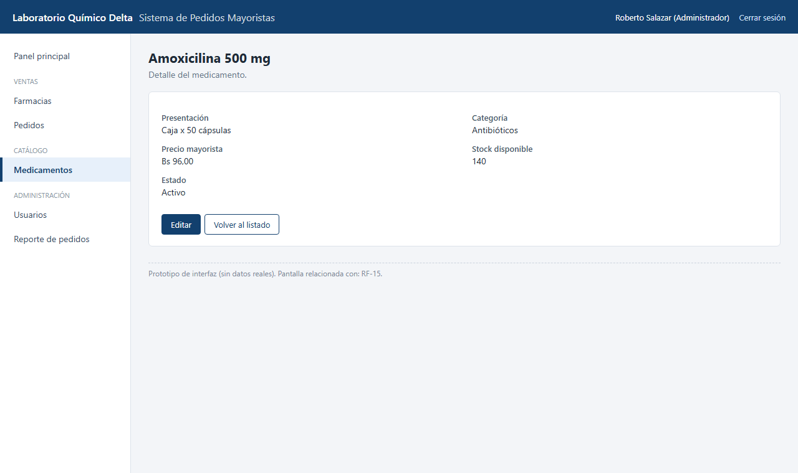

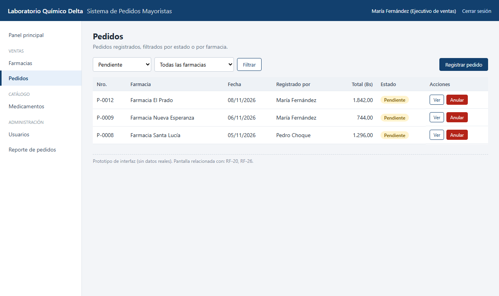

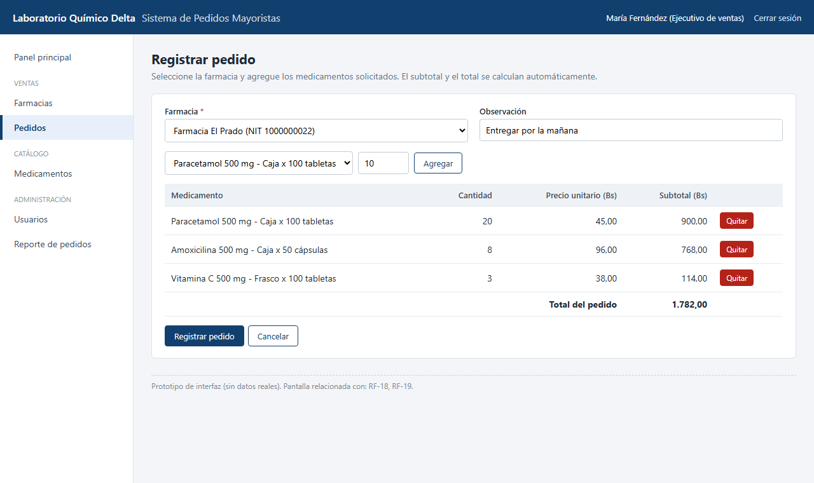

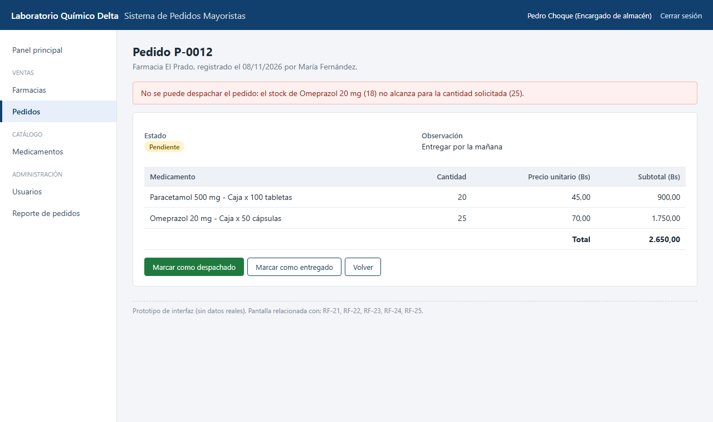

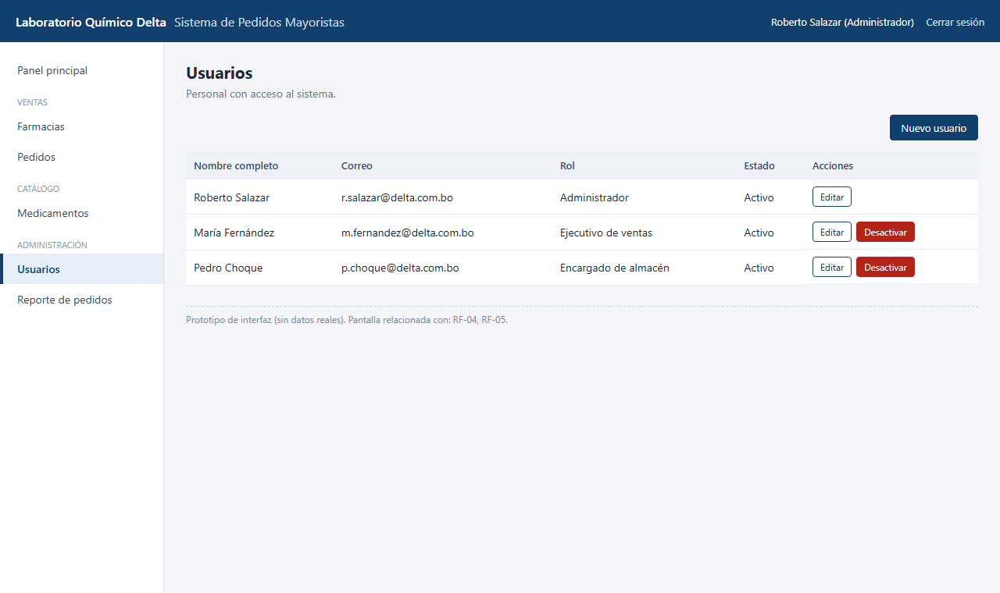

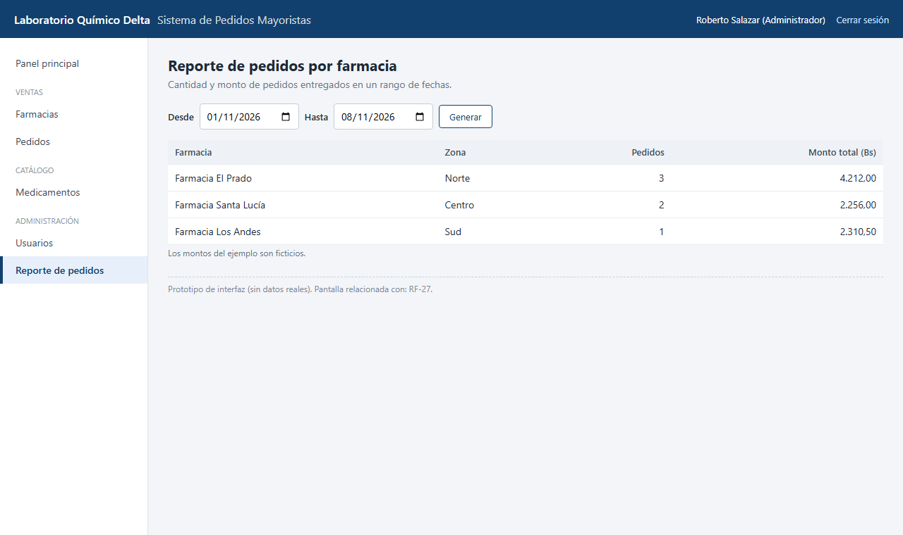

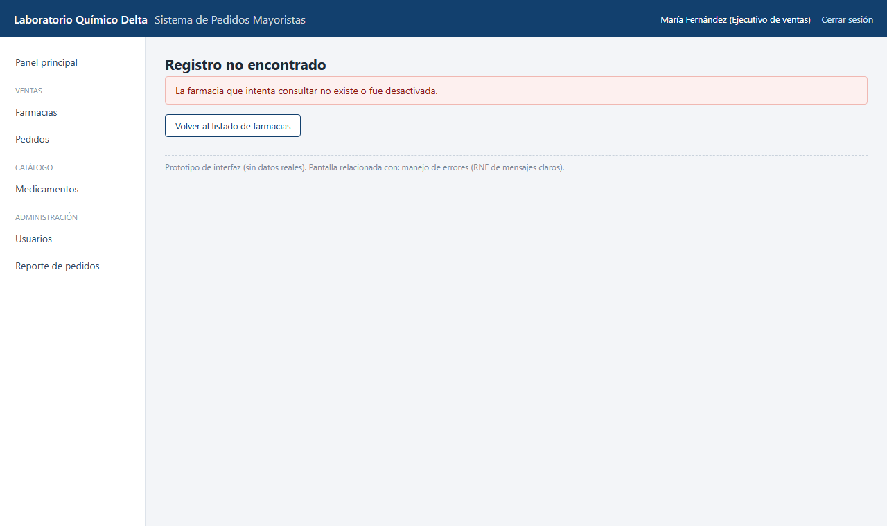
