# 1. Introducción

En las dos primeras actividades del semestre definimos y empezamos a construir el Sistema de Pedidos Mayoristas de Laboratorio Químico Delta, una empresa ficticia que fabrica medicamentos y los vende al por mayor a farmacias. En la Actividad 1 analizamos el proceso, levantamos los requerimientos, diseñamos la base de datos y armamos un prototipo navegable. En la Actividad 2 implementamos el backend de los módulos de Farmacias y Medicamentos con Node.js, Express y MySQL bajo el patrón MVC, y comprobamos sus operaciones CRUD.

Esta tercera entrega se concentra en la parte que ve y usa la persona: el frontend. El objetivo fue convertir las pantallas del prototipo en interfaces reales, conectadas al backend que ya existía, con navegación clara, formularios que validan los datos, listados que muestran información de la base de datos, mensajes comprensibles cuando algo sale bien o mal, y un diseño que funcione tanto en una computadora como en un celular.

El documento describe primero cómo está organizado el frontend y por qué elegimos esa forma de trabajo. Después recorre cada parte pedida en la actividad (página principal, menú, formularios, listados, integración, validaciones, mensajes y diseño adaptable) y termina con las evidencias de funcionamiento, el estado del repositorio y la relación entre lo implementado y los requerimientos de la Actividad 1.

# 2. Desarrollo de contenido

## 2.1 Descripción general del frontend

El frontend implementado cubre los dos módulos construidos en la Actividad 2, Farmacias y Medicamentos, más una página principal nueva. Desde la interfaz se puede registrar una farmacia o un medicamento, consultar el listado, buscar y filtrar, ver el detalle, modificar los datos y desactivar un registro. Todo lo que aparece en pantalla se obtiene de la base de datos MySQL a través del servidor; no hay datos escritos a mano en las vistas.

El proyecto es el mismo que se aprobó en la Actividad 1 y usa el mismo backend de la Actividad 2. No cambiamos nombres de campos ni rutas: el trabajo consistió en rehacer las vistas, agregar los elementos comunes de la interfaz y sumar el comportamiento en el navegador que antes no existía.

En la planificación de la Actividad 1 habíamos dejado para esta etapa también el inicio de sesión, los usuarios, las categorías, los pedidos y el reporte. Al revisar el enunciado de la Actividad 3 vimos que lo que se pide es desarrollar las interfaces a partir de los módulos implementados en la Actividad 2, así que ajustamos el alcance a eso. Los demás módulos quedan registrados como pendientes en la matriz de trazabilidad (apartado 2.13) y se construirán en las siguientes entregas. Lo que sí adelantamos fue la búsqueda de farmacias por nombre o NIT (RF-11), que ya funcionaba en el backend y ahora tiene su propia interfaz con estados de resultado vacío.

## 2.2 Estructura y organización de las interfaces

### Arquitectura de presentación

La guía de la actividad describe dos formas de organizar la presentación: un frontend separado que consume una API REST, o vistas generadas por el servidor dentro de MVC. Nuestro diagrama C4 de contenedores define una sola aplicación web Express que entrega páginas HTML, por lo que seguimos la segunda alternativa y no creamos un proyecto de frontend aparte.

En esta arquitectura el navegador pide una ruta (por ejemplo /farmacias), Express la dirige al controlador, el controlador consulta al modelo, el modelo ejecuta la consulta en MySQL y el resultado se entrega a una vista EJS que arma el HTML. Los formularios envían sus datos con POST a rutas del mismo servidor. Sobre esa base agregamos un archivo de JavaScript que mejora la experiencia en el navegador (validar antes de enviar, mostrar estados de carga, pedir confirmación), pero que no reemplaza a la validación del servidor.

| Tecnología | Versión | Uso en el frontend |
| --- | --- | --- |
| Node.js | 26.13.0 | Entorno donde corre el servidor. |
| Express | 4.22.3 | Rutas, controladores y archivos estáticos (CSS, JS, imágenes). |
| EJS | 7.0.2 | Plantillas que generan el HTML de cada pantalla. |
| HTML5 y CSS3 | | Estructura semántica y estilos globales con variables. |
| JavaScript (sin framework) | | Validación, estados de carga, menú en celular y cuadro de confirmación. |
| MySQL | 8.4 | Origen de todos los datos mostrados. |

Decidimos no usar Bootstrap, que la actividad sugiere como opción. El prototipo aprobado en la Actividad 1 ya tenía una hoja de estilos propia con los colores y la distribución del sistema, y la guía pide que las pantallas sean coherentes con ese prototipo. Pasar todo a Bootstrap habría cambiado el aspecto aprobado y agregado una dependencia que no necesitábamos para pantallas de este tamaño. En su lugar ordenamos la hoja de estilos con variables de color y reglas para distintos anchos de pantalla.

### Estructura de carpetas

```
sistema-pedidos-delta/
├── public/
│   ├── css/estilos.css        estilos globales y diseño adaptable
│   ├── js/app.js              comportamiento de la interfaz en el navegador
│   └── img/logo-delta.svg     logotipo del sistema
└── src/
    ├── app.js                 configuración de Express, rutas y manejo de errores
    ├── controllers/           inicioController, farmaciaController, medicamentoController
    ├── models/                consultas a MySQL
    ├── routes/                rutas de farmacias y medicamentos
    ├── validators/            reglas de validación del servidor
    └── views/
        ├── partials/          encabezado, pie, alerta y campo (componentes)
        ├── farmacias/         index, detalle y form
        ├── medicamentos/      index, detalle y form
        ├── errores/           404, 500 y sin-conexion
        └── inicio.ejs         panel principal
```

| Carpeta o archivo | Responsabilidad |
| --- | --- |
| src/views/farmacias y src/views/medicamentos | Pantallas completas de cada módulo: listado, detalle y formulario (el mismo formulario sirve para registrar y para editar). |
| src/views/partials | Componentes reutilizables. encabezado.ejs tiene la cabecera y el menú; pie.ejs, el pie y el cuadro de confirmación; alerta.ejs, el mensaje de éxito; campo.ejs, un campo de formulario con su etiqueta, ayuda y error. |
| src/views/errores | Páginas de "no encontrado", error general y sin conexión con la base de datos. |
| src/routes | Define qué controlador atiende cada dirección. Cumple el papel de las rutas del frontend en esta arquitectura. |
| public/css/estilos.css | Estilos globales. Los colores, el radio de los bordes y el espaciado están definidos una sola vez como variables. |
| public/js/app.js | Funciones que se ejecutan en el navegador. No hace solicitudes propias al servidor: trabaja sobre los formularios y enlaces de cada vista. |

El componente campo.ejs fue el cambio que más ordenó las vistas. Antes cada formulario repetía para cada campo el mismo bloque de etiqueta, control y mensaje de error; ahora cada campo es una sola línea que llama al componente con su nombre, su valor y sus reglas, y todos los formularios quedan iguales.

## 2.3 Diseño de la página principal

### Reglas visuales

Tomamos del prototipo de la Actividad 1 los colores, la tipografía y la distribución (cabecera azul, menú lateral blanco y contenido sobre fondo gris claro) y los definimos en la hoja de estilos como variables, para que cualquier pantalla nueva use los mismos valores.

| Elemento | Valor | Uso |
| --- | --- | --- |
| Azul principal | #12406e | Cabecera, botón principal (Guardar, Nueva farmacia) y opción activa del menú. |
| Rojo | #b42318 | Acciones de riesgo (Desactivar) y mensajes de error. |
| Verde | #1d5e33 | Mensajes de éxito. |
| Ámbar | #7a5a00 | Avisos de stock bajo. |
| Fondo / bordes | #f3f5f8 / #dde3ea | Fondo general y separación de tarjetas y tablas. |
| Tipografía | Segoe UI, 15 px | Texto general; títulos de 22 px y etiquetas de 14 px. |
| Foco del teclado | #f5a623 | Borde naranja visible en el elemento seleccionado con Tab. |

Los botones tienen tres estilos con significado distinto: el principal (azul relleno) para la acción esperada, el secundario (borde azul) para Cancelar, Volver o Ver, y el de riesgo (rojo) solo para Desactivar.

### Panel principal

La página de inicio pasó de ser una lista de enlaces a un panel con información real. Muestra la cantidad de farmacias activas, la cantidad de medicamentos en el catálogo y cuántos medicamentos tienen stock bajo (menos de 100 unidades), además de accesos rápidos para registrar y buscar. Las cifras se calculan con consultas COUNT en el momento en que se abre la página. La lista de medicamentos con stock bajo enlaza al detalle de cada uno.


En la prueba R-10 bajamos el stock de un medicamento a 40 unidades desde la interfaz y, al volver al inicio, el contador pasó de 2 a 3 y el medicamento apareció en la lista. Así comprobamos que el panel refleja los cambios de la base de datos y no muestra valores fijos.

## 2.4 Implementación del menú y navegación

La estructura común de todas las pantallas está en el componente encabezado.ejs: la cabecera con el logotipo y el nombre del sistema, el menú y la zona de contenido. El menú solo incluye los módulos que existen en esta versión (Inicio, Farmacias y Medicamentos), agrupados en Ventas y Catálogo como en el prototipo. No mostramos opciones de pedidos o usuarios porque todavía no tienen pantallas, y tampoco un nombre de usuario en la cabecera porque el sistema aún no tiene inicio de sesión.

La opción activa se marca de dos formas: visualmente, con fondo celeste y una barra azul a la izquierda, y para los lectores de pantalla, con el atributo aria-current. Dentro de cada módulo agregamos una línea de ubicación (por ejemplo "Farmacias / Editar") que permite volver al listado sin usar el botón Atrás del navegador.

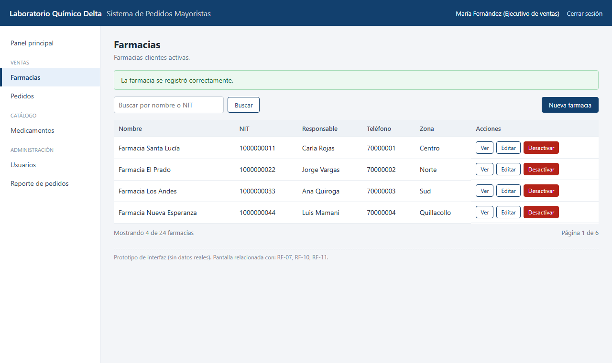


### Rutas de las pantallas

| Pantalla | Ruta | Cómo se llega |
| --- | --- | --- |
| Panel principal | / | Opción Inicio del menú o logotipo. |
| Listado de farmacias | /farmacias | Opción Farmacias del menú. |
| Búsqueda de farmacias | /farmacias?buscar=texto | Formulario de búsqueda del listado. |
| Registrar farmacia | /farmacias/nueva | Botón Nueva farmacia o acceso rápido del inicio. |
| Detalle de farmacia | /farmacias/:id | Nombre de la farmacia o botón Ver. |
| Editar farmacia | /farmacias/:id/editar | Botón Editar del listado o del detalle. |
| Catálogo de medicamentos | /medicamentos | Opción Medicamentos del menú. |
| Filtro por categoría | /medicamentos?categoria=id | Lista de categorías del catálogo. |
| Registrar medicamento | /medicamentos/nuevo | Botón Nuevo medicamento. |
| Detalle de medicamento | /medicamentos/:id | Nombre del medicamento o botón Ver. |
| Editar medicamento | /medicamentos/:id/editar | Botón Editar. |
| No encontrado | cualquier otra ruta | Página controlada con botón para volver. |

Cada ruta se probó desde el menú y escribiéndola en la barra de direcciones. Una ruta que no existe, como /proveedores, o un registro inexistente, como /farmacias/9999, muestran una página de "no encontrado" con un botón para volver, sin detalles técnicos.

## 2.5 Desarrollo de formularios

Los formularios de farmacia y de medicamento siguen los campos del modelo de datos de la Actividad 1. El mismo formulario se usa para registrar y para editar: al registrar, el título dice "Registrar farmacia" y el botón "Guardar"; al editar, el título incluye el nombre del registro que se está modificando y el botón dice "Guardar cambios". En ningún caso se le pide al usuario el identificador, porque lo genera la base de datos.

| Campo visual | Control | Atributo en la base de datos | Regla |
| --- | --- | --- | --- |
| Nombre (farmacia) | Texto | farmacia.nombre | Obligatorio, hasta 100 caracteres. |
| NIT | Texto numérico | farmacia.nit | Obligatorio, solo números, de 7 a 20 dígitos, único. |
| Responsable | Texto | farmacia.responsable | Opcional, hasta 100 caracteres. |
| Teléfono | Teléfono | farmacia.telefono | Obligatorio, números, espacios, + o -, de 7 a 20 caracteres. |
| Dirección | Texto | farmacia.direccion | Obligatorio, hasta 150 caracteres. |
| Zona | Lista desplegable | farmacia.zona | Una de las zonas de Cochabamba definidas. |
| Nombre (medicamento) | Texto | medicamento.nombre | Obligatorio; junto con la presentación no se puede repetir. |
| Presentación | Texto | medicamento.presentacion | Obligatorio, hasta 80 caracteres. |
| Categoría | Lista desplegable | medicamento.id_categoria | Debe ser una categoría existente; la lista muestra el nombre, no el número. |
| Precio mayorista (Bs) | Número decimal | medicamento.precio_mayorista | Obligatorio, mayor que cero, hasta dos decimales. Acepta coma o punto. |
| Stock | Número entero | medicamento.stock | Obligatorio, entero, cero o mayor. |

Todos los campos tienen una etiqueta visible asociada al control, los obligatorios llevan un asterisco y, para los lectores de pantalla, el texto "(obligatorio)". Debajo de los campos que pueden generar dudas hay un texto de ayuda con el formato esperado, por ejemplo "Solo números, de 7 a 20 dígitos" en el NIT. Los controles numéricos usan inputmode para que el celular muestre el teclado de números.

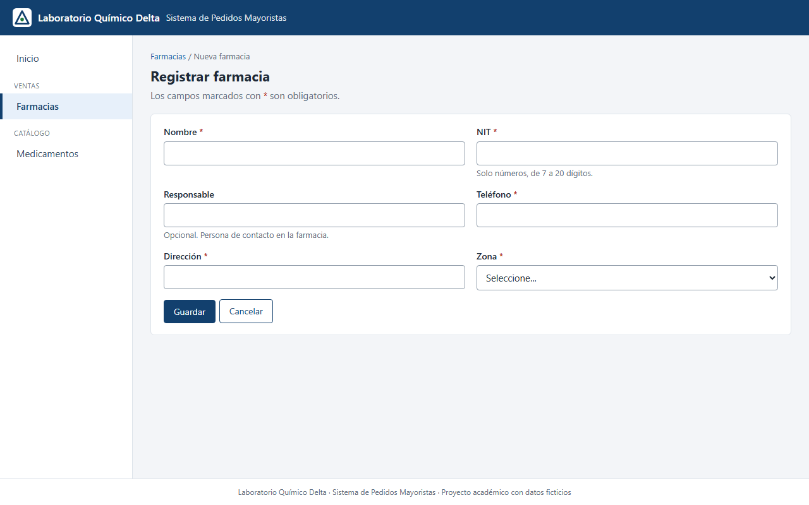
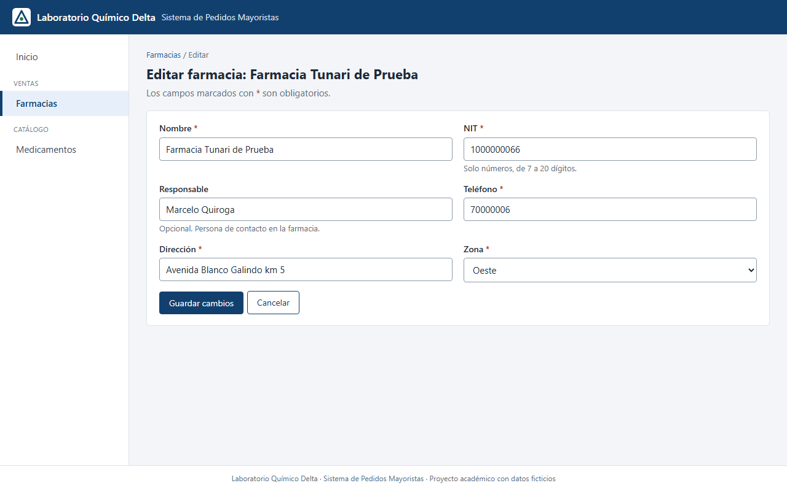

## 2.6 Visualización de registros mediante tablas o listados

Los listados muestran las columnas que le sirven al usuario y no los identificadores internos. En medicamentos la categoría aparece con su nombre, que el modelo obtiene con un INNER JOIN, y el precio se muestra siempre con dos decimales. Cuando un medicamento tiene menos de 100 unidades, la columna de stock agrega la etiqueta "Stock bajo", con texto y no solo con color.

| Columna | Dato de la base de datos | Observación |
| --- | --- | --- |
| Nombre | farmacia.nombre / medicamento.nombre | Es un enlace al detalle. |
| NIT, Responsable, Teléfono, Zona | columnas de farmacia | Si no hay responsable se muestra "No registrado". |
| Presentación | medicamento.presentacion | |
| Categoría | categoria.nombre | Se obtiene con INNER JOIN, no se muestra el id. |
| Precio mayorista (Bs) | medicamento.precio_mayorista | Alineado a la derecha y con dos decimales. |
| Stock | medicamento.stock | Etiqueta "Stock bajo" si es menor a 100. |
| Acciones | | Ver, Editar y Desactivar, con nombres accesibles que incluyen el registro. |

El listado de farmacias tiene una búsqueda por nombre o NIT y el catálogo de medicamentos un filtro por categoría. Ambos envían la consulta al servidor, que filtra en SQL con parámetros. Si la búsqueda no encuentra nada, en lugar de una tabla vacía aparece un mensaje que repite el texto buscado y un botón para ver todos los registros; si la tabla está realmente vacía, el mensaje invita a registrar el primer elemento. Al pie de cada listado se indica cuántos registros se están mostrando.

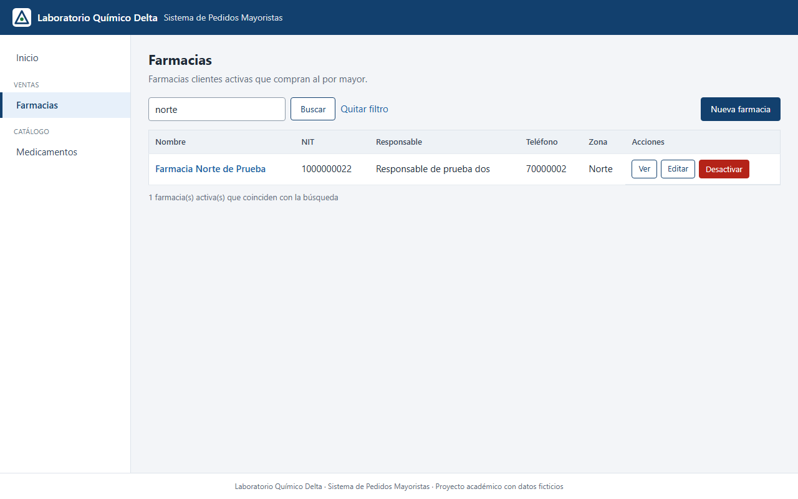
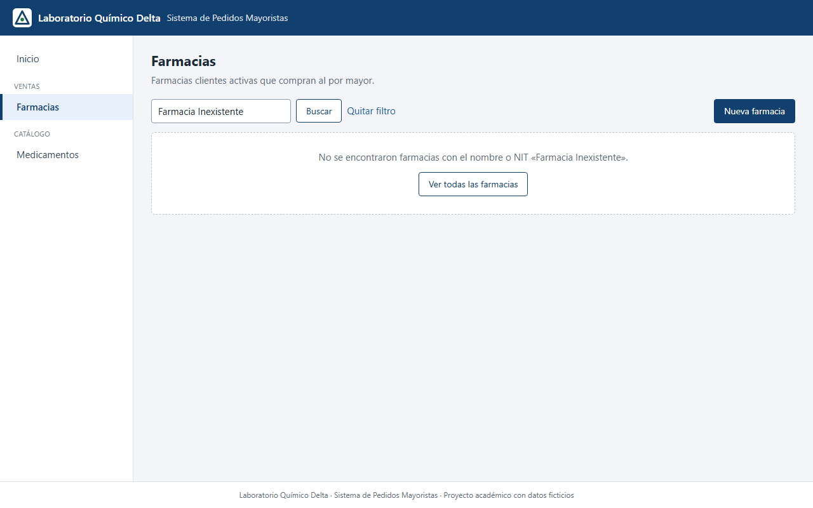
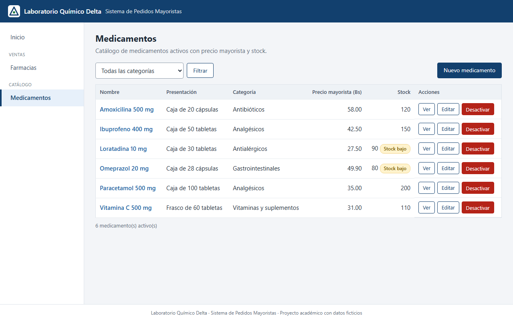
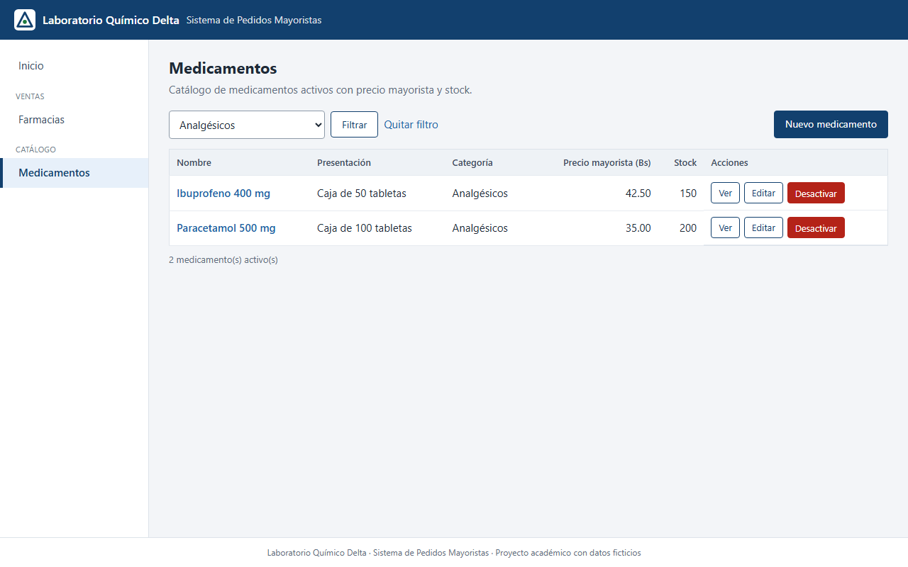

## 2.7 Integración del frontend con el backend

Como trabajamos con MVC y vistas del servidor, no hay un cliente HTTP separado ni una URL de API que configurar en el navegador. Cada pantalla se conecta con el backend mediante las rutas y acciones de la Actividad 2. La dirección y el puerto del servidor, así como los datos de conexión a MySQL, están en el archivo .env, que no se sube al repositorio; en GitHub solo está .env.example con los nombres de las variables y sin contraseñas.

El flujo de una operación es siempre el mismo: pantalla, envío del formulario o clic en un enlace, ruta de Express, controlador, validación, modelo, MySQL y, de vuelta, la vista o una redirección con el mensaje de resultado.

| Acción en la interfaz | Método y ruta | Controlador | Respuesta |
| --- | --- | --- | --- |
| Abrir el listado o buscar | GET /farmacias | farmaciaController.listar | Vista con los registros de la base. |
| Guardar una farmacia nueva | POST /farmacias | farmaciaController.crear | 302 al listado con mensaje, o 422/409 con el formulario y los errores. |
| Abrir el detalle | GET /farmacias/:id | farmaciaController.detalle | Vista de detalle o 404. |
| Guardar cambios | POST /farmacias/:id/editar | farmaciaController.actualizar | 302 al detalle con mensaje, o el formulario con errores. |
| Confirmar la desactivación | POST /farmacias/:id/desactivar | farmaciaController.desactivar | 302 al listado; la fila queda con activo = 0. |
| Las mismas acciones en el catálogo | GET y POST /medicamentos... | medicamentoController | Igual que en farmacias. |
| Abrir el inicio | GET / | inicioController.panel | Panel con las cifras calculadas en ese momento. |

Para comprobar que cada acción de la interfaz realmente llega al servidor agregamos un pequeño middleware que escribe en la consola el método, la ruta, el código de respuesta y el tiempo de cada solicitud. Este es un fragmento del registro durante el recorrido de pruebas; el registro completo está en el Anexo B.

```
GET /farmacias/nueva -> 200 (5 ms)
POST /farmacias -> 302 (10 ms)
GET /farmacias?ok=registrada -> 200 (4 ms)
GET /farmacias/14/editar -> 200 (4 ms)
POST /farmacias/14/editar -> 302 (11 ms)
POST /farmacias -> 409 (15 ms)
POST /farmacias/14/desactivar -> 302 (9 ms)
GET /farmacias?ok=desactivada -> 200 (4 ms)
```

Además de ver el resultado en pantalla, después de cada operación consultamos la tabla en MySQL. Por ejemplo, la farmacia registrada desde el formulario en la prueba R-05 quedó así en la base de datos:

```
mysql> SELECT id_farmacia, nombre, nit, telefono, zona, activo FROM farmacia WHERE nit = '1000000066';
+-------------+---------------------------+------------+----------+-------+--------+
| id_farmacia | nombre                    | nit        | telefono | zona  | activo |
+-------------+---------------------------+------------+----------+-------+--------+
|          14 | Farmacia Tunari de Prueba | 1000000066 | 70000006 | Oeste |      1 |
+-------------+---------------------------+------------+----------+-------+--------+
```

Las demás consultas (la actualización, la desactivación lógica y el medicamento registrado) están en el Anexo A.

## 2.8 Validación de formularios

La validación se hace en dos lados. En el navegador, public/js/app.js revisa los campos cuando el usuario presiona Guardar; si hay errores, marca cada campo en rojo, escribe el mensaje debajo, pone el foco en el primer campo con error y no envía nada al servidor. Mientras el usuario corrige un campo marcado, el mensaje se actualiza al momento. Las reglas y los textos de los mensajes son los mismos de los validadores del servidor, para que el usuario lea lo mismo sin importar dónde se detectó el error.

La validación del navegador es solo una ayuda. El servidor vuelve a validar todo con src/validators, porque cualquiera podría desactivar el JavaScript o enviar una solicitud sin pasar por el formulario. Además, hay reglas que solo el servidor puede comprobar porque dependen de la base de datos: que el NIT no esté repetido, que la categoría exista o que no haya otro medicamento con el mismo nombre y presentación.

| Situación | Dónde se detecta | Mensaje que ve el usuario |
| --- | --- | --- |
| Campos obligatorios vacíos | Navegador y servidor | "El nombre es obligatorio.", "Seleccione una zona.", etc. |
| NIT con letras | Navegador y servidor | "El NIT debe tener solo números (entre 7 y 20 dígitos)." |
| Teléfono con letras | Navegador y servidor | "El teléfono solo puede tener números, espacios, + o - (de 7 a 20 caracteres)." |
| Precio cero o negativo | Navegador y servidor | "El precio debe ser mayor que cero." |
| Stock con decimales | Navegador y servidor | "El stock debe ser un número entero." |
| NIT ya registrado | Solo servidor (409) | "Ya existe una farmacia registrada con este NIT." |
| Medicamento repetido | Solo servidor (409) | "Ya existe un medicamento con el mismo nombre y presentación." |

En la prueba R-04 presionamos Guardar con el formulario vacío y luego con un NIT y un teléfono inválidos: aparecieron los cinco errores de los campos obligatorios y después los de formato, y el navegador no envió ninguna solicitud POST. En la prueba R-07 intentamos registrar un NIT existente: el navegador no puede saberlo, el servidor respondió 409, mostró el error junto al campo NIT y conservó lo que el usuario había escrito.

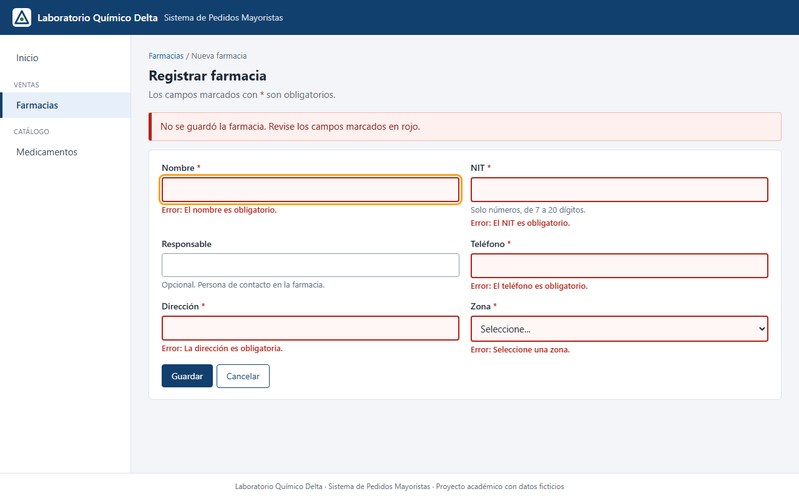
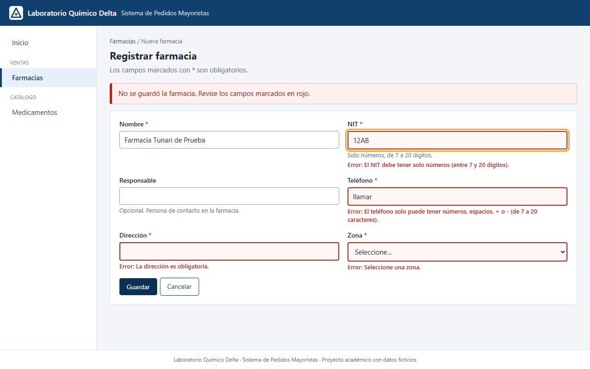
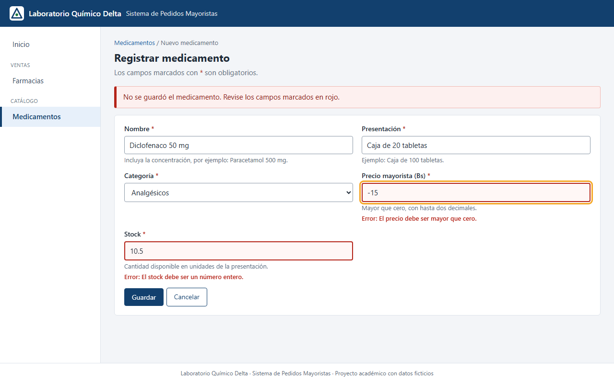
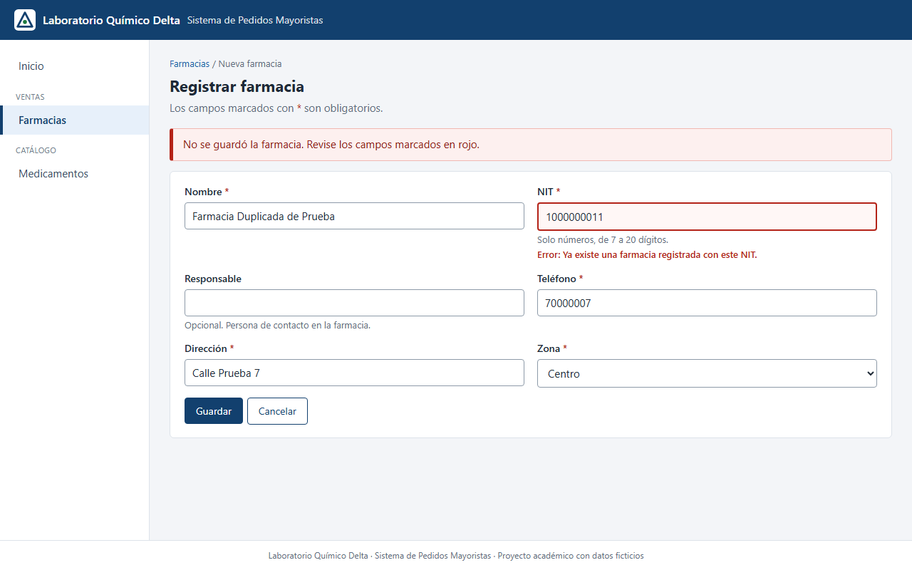

## 2.9 Mensajes de confirmación y manejo de errores

### Mensajes de éxito

Después de registrar, editar o desactivar, el servidor redirige al listado o al detalle con un parámetro que indica qué ocurrió, y la vista muestra un mensaje verde, por ejemplo "Listo. La farmacia se registró correctamente." El mensaje no desaparece solo, para que el usuario alcance a leerlo; se cierra con el botón de la equis. Tiene el rol status para que los lectores de pantalla lo anuncien.

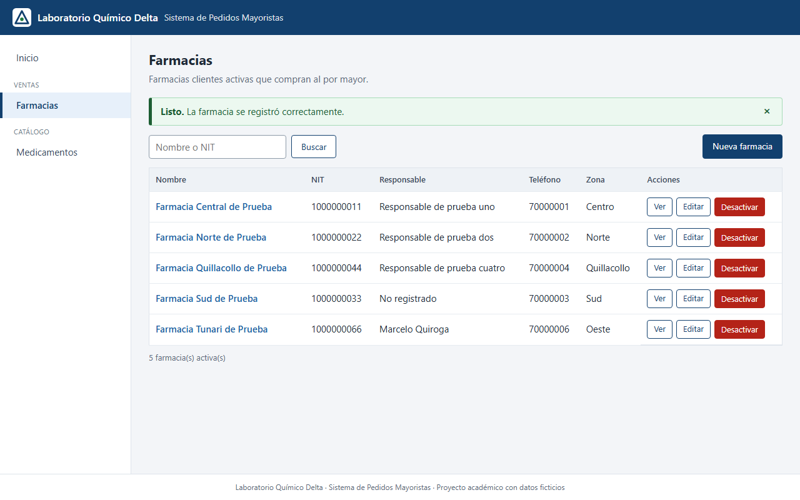
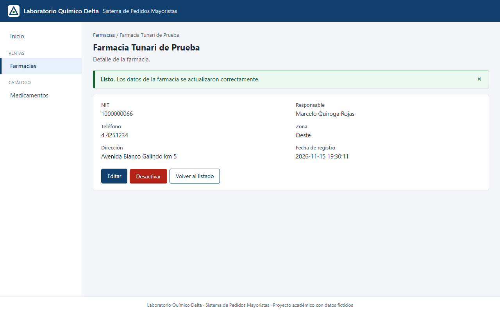

### Confirmación antes de desactivar

En la Actividad 2 la desactivación usaba la ventana confirm() del navegador, que no se puede adaptar. La reemplazamos por un cuadro de confirmación propio, hecho con el elemento dialog de HTML, que nombra el registro afectado y explica la consecuencia: la farmacia deja de aparecer en el listado, pero su historial de pedidos se conserva. Tiene dos botones con acciones distintas, Cancelar (que recibe el foco por defecto) y "Sí, desactivar" en rojo. Al confirmar, el botón se deshabilita para que la operación no se envíe dos veces.

La eliminación es lógica, como se definió en el diseño: la fila no se borra, solo cambia su columna activo a 0. La interfaz refleja esa regla: el registro sale del listado, pero sigue existiendo en la base de datos.

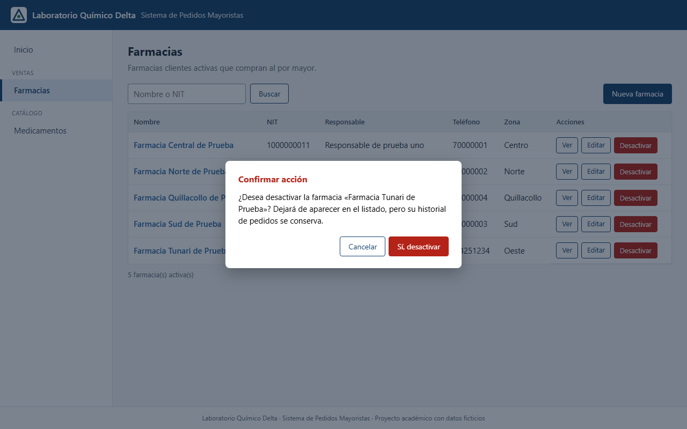
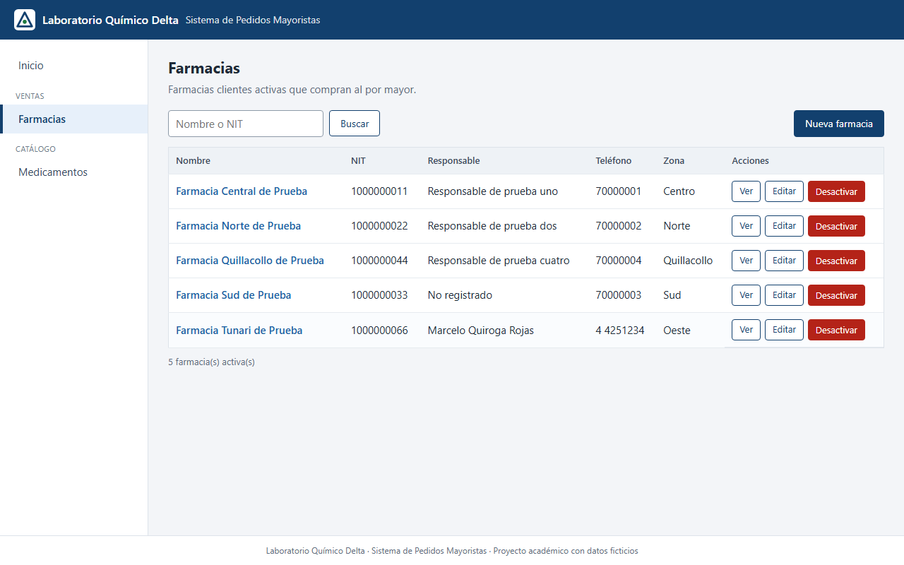
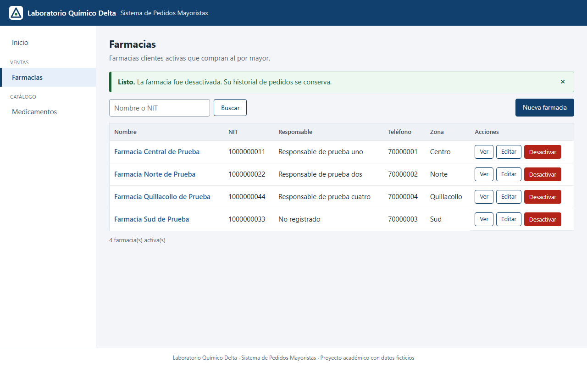

### Estados de carga

Cuando el usuario presiona Guardar con datos válidos, el botón se deshabilita y cambia su texto a "Guardando...", y arriba de la pantalla aparece un aviso con un indicador giratorio. Así se evita que el formulario se envíe dos veces y el usuario sabe que el sistema está trabajando. Lo mismo ocurre al buscar, al filtrar y al navegar por el menú si el servidor tarda en responder ("Cargando...", "Buscando farmacias..."). Como en condiciones normales la respuesta llega en pocos milisegundos, para las capturas retrasamos la respuesta a propósito desde la herramienta de pruebas.

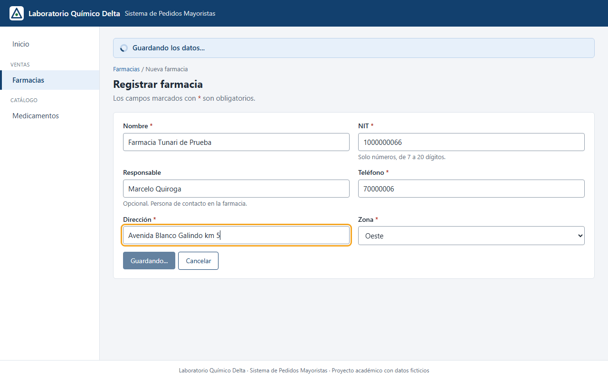
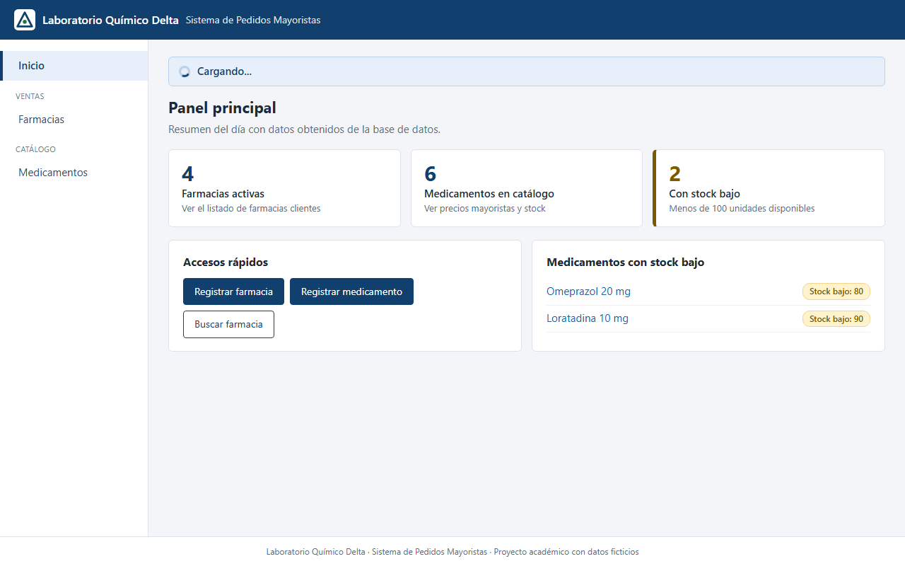

### Errores controlados

Ningún error muestra al usuario mensajes técnicos ni rutas internas; el detalle queda solo en la consola del servidor. Las páginas de error dicen qué pasó con palabras simples y ofrecen un camino para seguir.

| Situación | Código | Qué ve el usuario |
| --- | --- | --- |
| Ruta inexistente | 404 | "Página no encontrada" con botón para ir al inicio. |
| Registro inexistente o desactivado | 404 | "Farmacia no encontrada" con botón para volver al listado. |
| Datos inválidos | 422 | El mismo formulario con los errores y los datos escritos. |
| Dato duplicado | 409 | El formulario con el error junto al campo. |
| MySQL no responde | 503 | "No se pudo conectar con la base de datos" con botones Reintentar e Ir al inicio. |
| Cualquier otro error | 500 | Mensaje general y botón para volver al inicio. |

Para el caso sin conexión detuvimos MySQL con la aplicación abierta. Al abrir Farmacias apareció la página de error con el botón Reintentar; volvimos a iniciar MySQL, presionamos Reintentar y se mostró el listado normal.

En la primera ejecución de esa prueba encontramos un defecto: la primera solicitud después de detener MySQL no mostraba la página de sin conexión, sino la de error general (500). La causa fue que, mientras el servidor de base de datos se cierra, la conexión que ya estaba abierta devuelve el código ER_SERVER_SHUTDOWN, que no estaba en nuestra lista de errores de conexión (solo estaban ECONNREFUSED y otros). Lo agregamos a la lista, repetimos la prueba y quedó corregido.

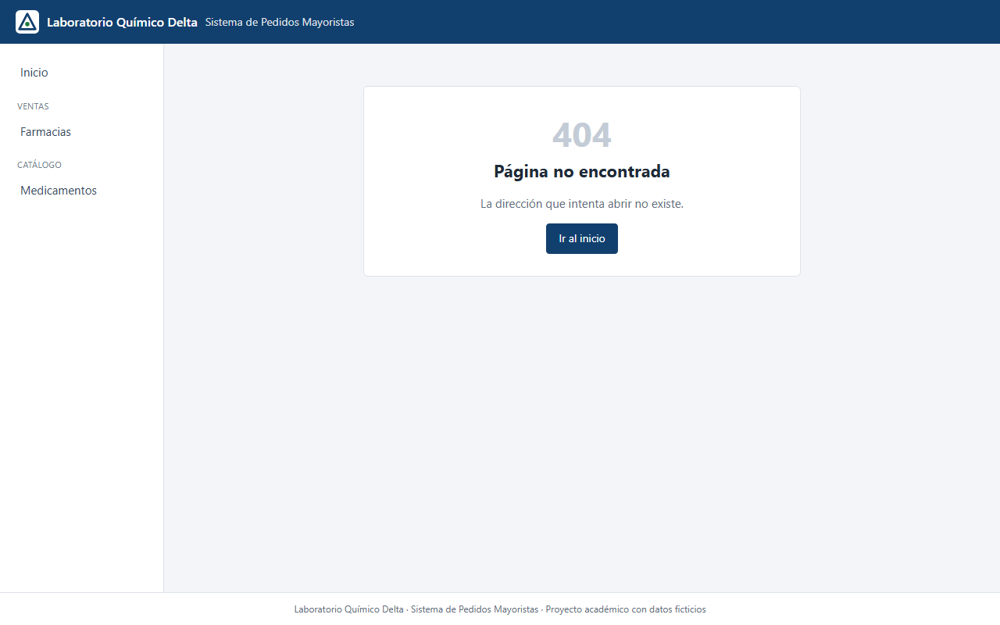
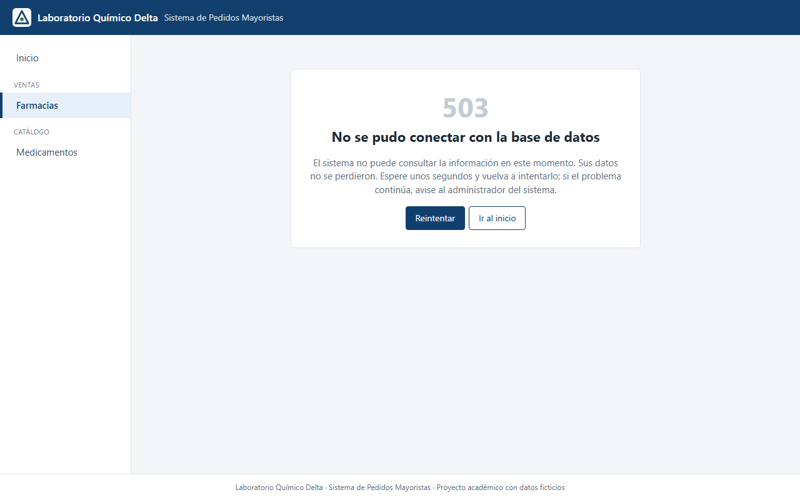

## 2.10 Adaptabilidad de las interfaces a diferentes dispositivos

La hoja de estilos define dos puntos de cambio. Hasta 820 píxeles de ancho (tabletas en vertical y celulares) el menú lateral se oculta y aparece un botón "Menú" en la cabecera que lo despliega; los formularios y el panel pasan a una sola columna. Hasta 640 píxeles (celulares) las tablas cambian de forma: cada fila se muestra como una tarjeta con el nombre arriba, cada dato con su etiqueta a la izquierda y los botones de acción a lo ancho. Elegimos tarjetas en lugar del desplazamiento horizontal porque en un celular es más cómodo leer de arriba hacia abajo que mover la tabla de costado.

Probamos las pantallas con 1280 píxeles (escritorio), 768 (tableta) y 390 (celular). En el celular comprobamos que el ancho de la página fuera exactamente 390 píxeles, es decir, que ningún elemento se saliera de la pantalla.

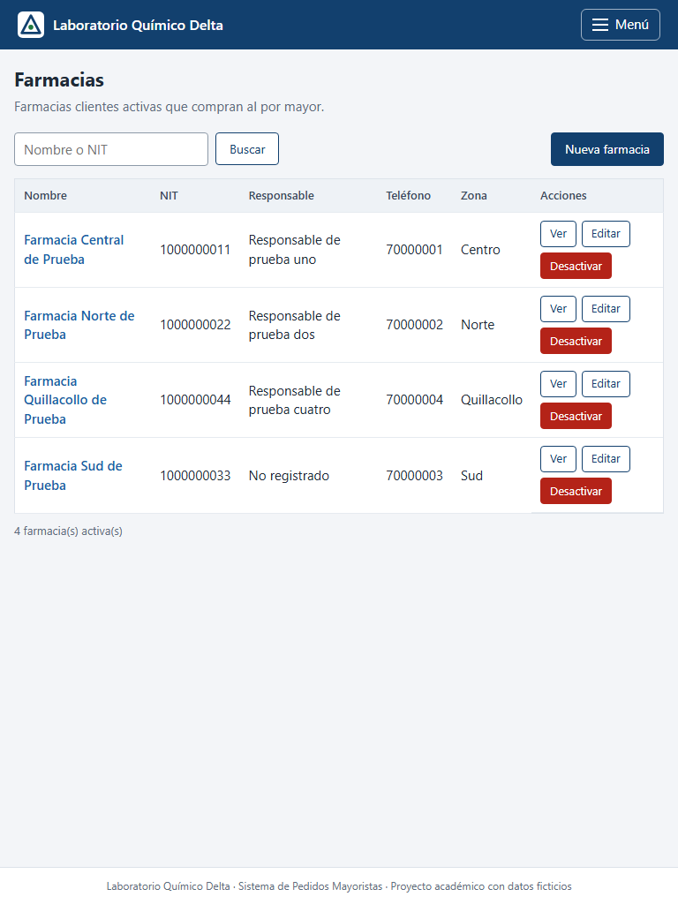
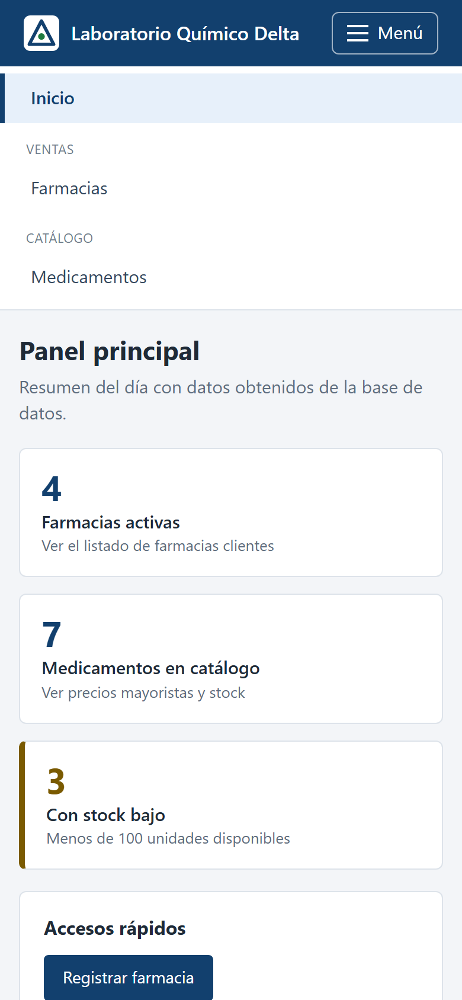
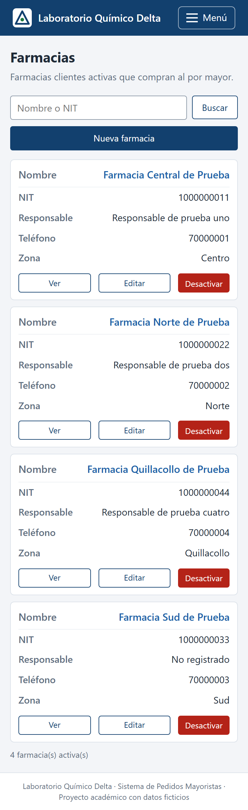
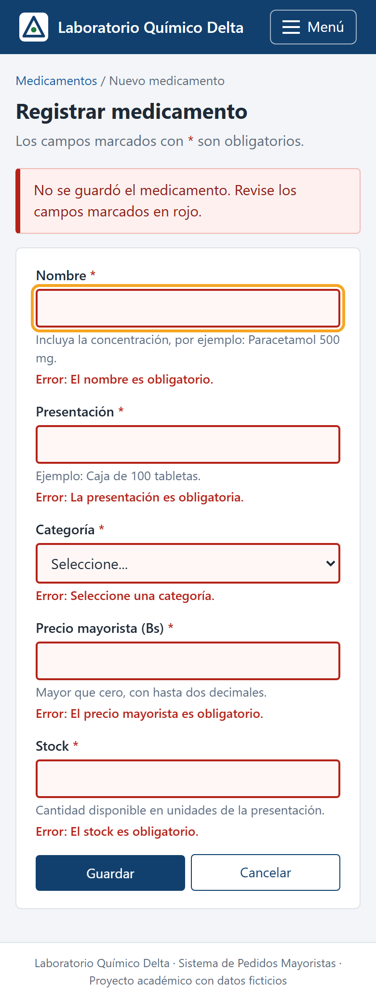

### Accesibilidad básica

No hicimos una auditoría profesional, pero sí revisamos los puntos básicos que propone la guía:

| Comprobación | Resultado |
| --- | --- |
| Cada campo tiene una etiqueta asociada. | Sí, con label for; el buscador y el filtro tienen etiquetas ocultas para lectores de pantalla. |
| Se puede recorrer el formulario con la tecla Tab. | Sí. El primer Tab ofrece "Saltar al contenido" para no recorrer todo el menú. |
| El foco del teclado es visible. | Sí, con un borde naranja de 3 px en el elemento seleccionado. |
| Los errores no dependen solo del color. | Sí. Cada error tiene texto, empieza con "Error:" y el campo queda con borde más grueso y aria-invalid. |
| Los estados tienen texto. | Sí. "Stock bajo" se escribe; no es solo un color ámbar. |
| Los botones tienen nombres comprensibles. | Sí. No hay botones solo con iconos y en las tablas el nombre accesible incluye el registro, por ejemplo "Editar Farmacia Norte de Prueba". |
| Las imágenes tienen texto alternativo. | El logotipo de la cabecera es decorativo (alt vacío) porque el nombre del sistema ya está escrito al lado. |

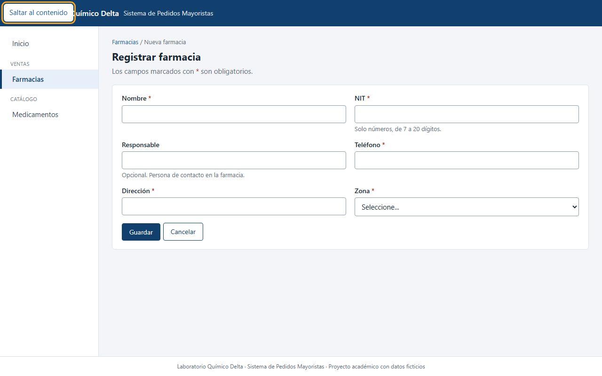
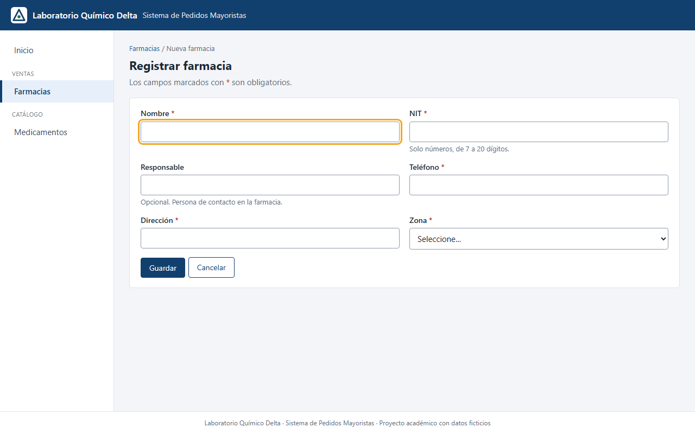

## 2.11 Evidencias de funcionamiento

Para comprobar el funcionamiento hicimos un recorrido completo desde la interfaz, sin usar Postman ni modificar la base de datos a mano. El recorrido está automatizado con Playwright en un script que abre el navegador, hace clic y escribe como lo haría un usuario, toma las capturas y, después de cada operación, consulta MySQL para confirmar el resultado. Usamos solo datos ficticios. El plan formal de pruebas se hará en la Actividad 4; esta tabla registra el recorrido funcional que pide esta actividad.

| N.º | Acción del usuario | Qué debía ocurrir | Resultado obtenido | Estado |
| --- | --- | --- | --- | --- |
| R-01 | Abrir la página principal. | Se muestra el panel con cifras tomadas de la base de datos. | El panel muestra 4 farmacias activas; la consulta SQL devuelve 4. | Correcto |
| R-02 | Elegir "Farmacias" en el menú. | Se abre el listado y la opción queda marcada como activa. | Se abrió /farmacias con la opción "Farmacias" marcada. | Correcto |
| R-03 | Buscar "norte" y luego un nombre que no existe. | Se listan solo las coincidencias; si no hay, aparece un mensaje claro. | 1 resultado en la primera búsqueda; en la segunda, "No se encontraron farmacias con el nombre o NIT «Farmacia Inexistente»." | Correcto |
| R-04 | Guardar con el formulario vacío y luego con NIT "12AB" y teléfono "llamar". | Los errores aparecen junto a cada campo y no se envía nada al servidor. | 5 campos marcados y luego los errores de formato. Solicitudes POST enviadas: 0. | Correcto |
| R-05 | Completar el formulario con datos válidos y guardar. | El botón se bloquea con "Guardando..."; luego aparece la confirmación y el registro existe en la base. | Botón "Guardando..." deshabilitado; mensaje de éxito; farmacia guardada con id 14. | Correcto |
| R-06 | Editar teléfono y responsable, guardar y recargar. | El formulario trae los datos actuales y después de recargar se ven los nuevos. | Valor cargado "70000006"; después de recargar, "4 4251234". | Correcto |
| R-07 | Registrar un NIT que ya existe. | El servidor rechaza el registro, lo explica junto al campo y conserva lo escrito. | Código 409, "Ya existe una farmacia registrada con este NIT." y el nombre escrito conservado. | Correcto |
| R-08 | Desactivar, cancelar y luego confirmar. | Al cancelar no cambia nada; al confirmar la farmacia sale del listado con activo = 0. | 5 filas antes, 5 al cancelar, 4 al confirmar; activo = 0 en la base. | Correcto |
| R-09 | Abrir Medicamentos y filtrar por Analgésicos. | Se ve "Cargando..." mientras responde el servidor y el filtro muestra solo esa categoría. | Indicador visible; 2 medicamentos de Analgésicos. | Correcto |
| R-10 | Registrar un medicamento con precio -15 y stock 10.5, corregirlo y bajar su stock a 40. | Se rechazan los valores inválidos; con datos correctos se guarda y el panel lo muestra con stock bajo. | Errores de precio y stock; registro guardado; el panel pasó a 3 medicamentos con stock bajo. | Correcto |
| R-11 | Abrir /proveedores y /farmacias/9999. | Página de "no encontrado" con botón para volver, sin detalles técnicos. | Código 404 en ambos casos. | Correcto |
| R-12 | Recorrer el formulario con Tab. | Aparece "Saltar al contenido" y el foco se ve en cada campo. | Se llegó al campo Nombre solo con el teclado. | Correcto |
| R-13 | Abrir las pantallas en 768 px y 390 px. | Menú con botón, tablas como tarjetas y sin desplazamiento horizontal. | Menú desplegado; ancho de la página en celular: 390 px. | Correcto |
| R-14 | Detener MySQL, abrir Farmacias y luego presionar Reintentar. | Mensaje comprensible con opción de reintentar; al volver la conexión se ve el listado. | Código 503 con el mensaje de sin conexión; al reintentar, código 200. | Correcto |

En la consola del navegador no hubo errores de JavaScript durante el recorrido. Los únicos avisos fueron los "Failed to load resource" que Chrome muestra cuando una página responde con 404, 409 o 503, y corresponden justamente a las pruebas R-07, R-11 y R-14.

A continuación están las capturas del recorrido que no aparecen en los apartados anteriores. Las demás capturas complementarias están en el Anexo C.

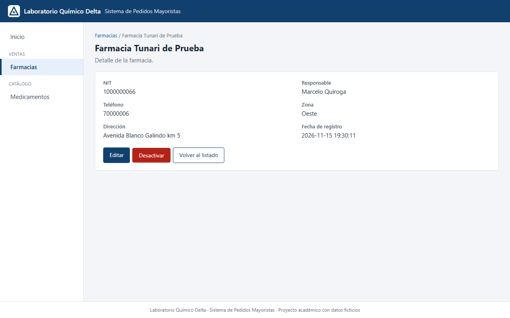
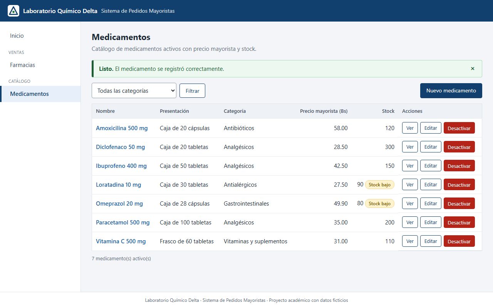
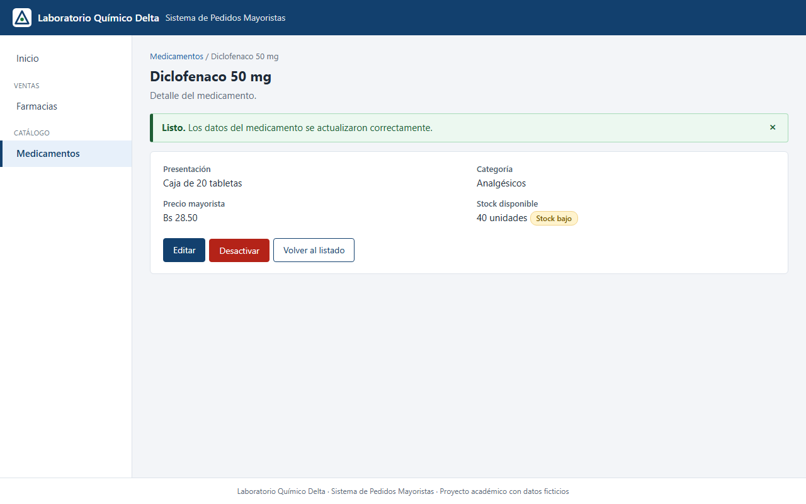
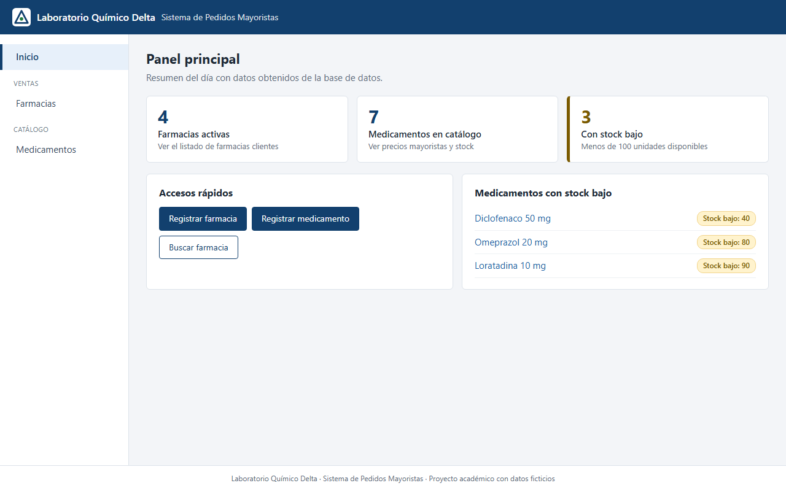

## 2.12 Repositorio GitHub actualizado

El código está en el mismo repositorio de las actividades anteriores:

https://github.com/GustavoRodVe/sistema-pedidos-delta

Siguiendo la recomendación de la guía, trabajamos el frontend en una rama propia, feature/frontend, y al terminar la unimos a la rama principal main. Antes de subir los cambios revisamos que el archivo .env no estuviera incluido (está en .gitignore) y que las capturas no mostraran contraseñas. Los commits de esta actividad son:

| Commit | Descripción |
| --- | --- |
| 6612f73 | Agrega el panel de inicio con datos reales, registro de solicitudes y página sin conexión |
| 86b2802 | Implementa el frontend de farmacias y medicamentos: validación en el navegador, confirmación, estados de carga y diseño adaptable |
| 066c053 | Actualiza el README y agrega las evidencias del recorrido de la Actividad 3 |
| bdbfd85 | Muestra la página sin conexión también cuando MySQL se está deteniendo |

A estos se suma un commit con este documento y su PDF, y el commit de unión de la rama feature/frontend con main. Después de subir los cambios comprobamos en GitHub que los commits y las carpetas aparecieran correctamente.

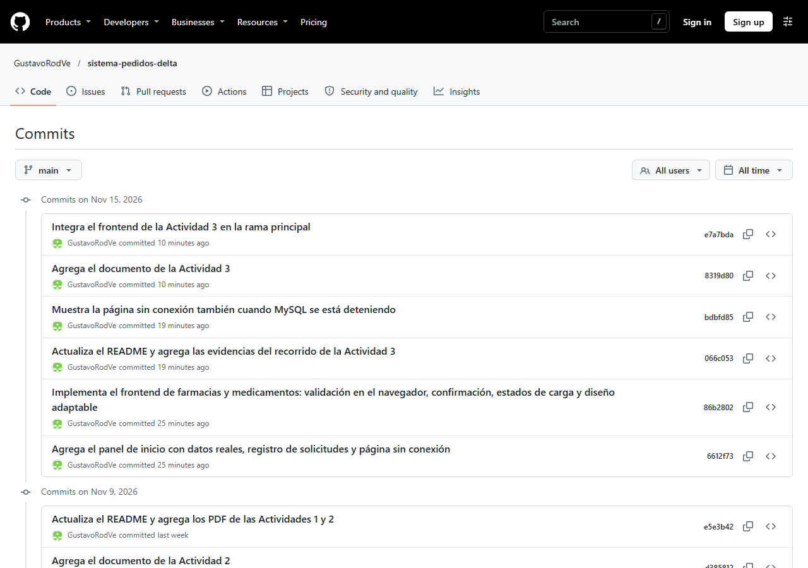
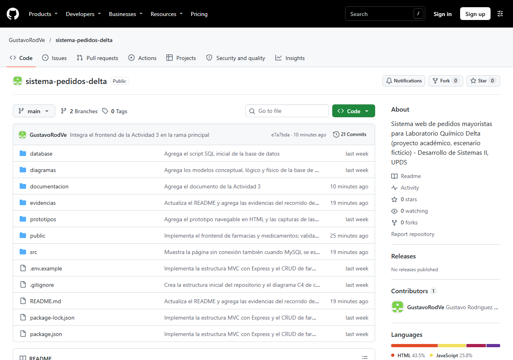

El README se actualizó con la arquitectura del frontend, la tabla de pantallas y rutas, la estructura de carpetas y la forma de configurar el servidor con el archivo .env. Las evidencias de esta actividad están en la carpeta evidencias/actividad-3 (capturas, registro de la consola y resultados del recorrido) y el script que las genera, en la carpeta de herramientas del proyecto.

## 2.13 Trazabilidad con los requerimientos

| Requerimiento | Pantalla | Acción del usuario | Backend | Estado |
| --- | --- | --- | --- | --- |
| RF-03 Panel principal con accesos | Inicio | Abrir el sistema | GET / (inicioController.panel) | Parcial: el panel existe, pero sin roles todavía muestra los mismos accesos a todos. |
| RF-06 Registrar farmacia | Registrar farmacia | Guardar | POST /farmacias | Implementado |
| RF-07 Listado de farmacias activas | Farmacias | Opción del menú | GET /farmacias | Implementado |
| RF-08 Detalle de farmacia | Detalle de farmacia | Ver o clic en el nombre | GET /farmacias/:id | Implementado |
| RF-09 Modificar farmacia | Editar farmacia | Guardar cambios | POST /farmacias/:id/editar | Implementado |
| RF-10 Desactivar farmacia | Listado y detalle | Desactivar y confirmar | POST /farmacias/:id/desactivar | Implementado |
| RF-11 Buscar farmacias por nombre o NIT | Farmacias | Buscar | GET /farmacias?buscar= | Implementado |
| RF-13 Registrar medicamento | Registrar medicamento | Guardar | POST /medicamentos | Implementado |
| RF-14 Listado de medicamentos | Medicamentos | Opción del menú y filtro | GET /medicamentos | Implementado |
| RF-15 Detalle de medicamento | Detalle de medicamento | Ver | GET /medicamentos/:id | Implementado |
| RF-16 Modificar medicamento | Editar medicamento | Guardar cambios | POST /medicamentos/:id/editar | Implementado |
| RF-17 Desactivar medicamento | Listado y detalle | Desactivar y confirmar | POST /medicamentos/:id/desactivar | Implementado |
| RF-01, RF-02, RF-04 y RF-05 Sesión y usuarios | | | | Pendiente |
| RF-12 Registrar categoría | | | | Pendiente |
| RF-18 a RF-26 Pedidos, despacho y stock | | | | Pendiente |
| RF-27 Reporte de pedidos | | | | Pendiente |

No marcamos como implementado ningún requerimiento que solo tenga un botón o una pantalla sin operación real; por eso el menú tampoco muestra opciones de los módulos pendientes.

# 3. Conclusión

Con esta actividad el sistema dejó de ser un conjunto de pantallas funcionales pero básicas y pasó a tener una interfaz que una persona del laboratorio podría usar sin ayuda. Las pantallas siguen el prototipo de la Actividad 1, toman todos sus datos del backend de la Actividad 2 y responden de manera clara en cada situación: cuando los datos están bien, cuando están mal, cuando el servidor tarda y cuando la base de datos no está disponible.

La decisión más importante fue mantener la arquitectura MVC con vistas del servidor en lugar de crear un frontend separado. Eso nos permitió concentrarnos en la experiencia del usuario sin duplicar la lógica, y el JavaScript que agregamos quedó como una capa de ayuda que puede fallar sin poner en riesgo los datos, porque el servidor sigue validando todo. Escribir las reglas de validación igual en los dos lados tiene un costo: si una regla cambia hay que actualizarla en dos archivos. Lo dejamos anotado para revisarlo más adelante.

Automatizar el recorrido con Playwright nos sirvió más de lo esperado. Además de producir capturas consistentes, encontró un defecto real en el manejo de la caída de la base de datos que probando a mano probablemente no habríamos visto, porque solo ocurría en la primera solicitud.

Quedan pendientes el inicio de sesión con roles, los usuarios, las categorías, el módulo de pedidos con el descuento de stock y el reporte. Cuando exista el inicio de sesión habrá que mostrar en el menú solo las opciones de cada rol y completar el RF-03. En la Actividad 4 se hará el plan formal de pruebas y el despliegue, y el script de esta actividad puede servir como base para las pruebas de la interfaz.

# 4. Glosario

| Término | Significado |
| --- | --- |
| Accesibilidad | Conjunto de prácticas para que el sistema pueda usarse con teclado, lector de pantalla o con dificultades de visión. |
| Backend | Parte del sistema que recibe las solicitudes, aplica las reglas y accede a la base de datos. |
| Código de estado HTTP | Número con el que el servidor indica el resultado de una solicitud: 200 correcto, 302 redirección, 404 no encontrado, 409 conflicto, 422 datos inválidos, 503 servicio no disponible. |
| Componente | Parte de la interfaz que se reutiliza en varias pantallas, como el campo de formulario o el cuadro de confirmación. |
| Diseño adaptable (responsive) | Diseño que cambia su distribución según el ancho de la pantalla. |
| EJS | Motor de plantillas que mezcla HTML con JavaScript para generar las páginas en el servidor. |
| Eliminación lógica | Marcar un registro como inactivo en lugar de borrarlo, para conservar su historial. |
| Estado de interfaz | Situación que determina qué se muestra: cargando, con datos, sin resultados, guardado o error. |
| Frontend | Parte visual e interactiva de la aplicación: pantallas, menús, formularios, tablas y mensajes. |
| Middleware | Función de Express que se ejecuta en cada solicitud antes de llegar a la ruta, por ejemplo para registrarla en la consola. |
| MVC | Modelo-Vista-Controlador. Patrón que separa los datos (modelo), la presentación (vista) y la lógica que los une (controlador). |
| Playwright | Herramienta que controla un navegador desde un programa; la usamos para repetir el recorrido y tomar las capturas. |
| Punto de quiebre | Ancho de pantalla a partir del cual cambian los estilos (en este proyecto, 820 y 640 píxeles). |
| Ruta | Dirección dentro del sistema que abre una pantalla o ejecuta una acción, por ejemplo /farmacias/nueva. |
| Validación | Comprobación de que los datos cumplen las reglas antes de guardarlos. |

# 5. Anexos

## Anexo A. Comprobaciones en la base de datos

Consultas ejecutadas en MySQL con el usuario de la aplicación después de cada operación hecha desde la interfaz.

R-05: la farmacia registrada desde la interfaz está en la base de datos

```
mysql> SELECT id_farmacia, nombre, nit, telefono, zona, activo FROM farmacia WHERE nit = '1000000066';
+-------------+---------------------------+------------+----------+-------+--------+
| id_farmacia | nombre                    | nit        | telefono | zona  | activo |
+-------------+---------------------------+------------+----------+-------+--------+
|          14 | Farmacia Tunari de Prueba | 1000000066 | 70000006 | Oeste |      1 |
+-------------+---------------------------+------------+----------+-------+--------+
```

R-06: el cambio de teléfono persiste en la base de datos

```
mysql> SELECT id_farmacia, nombre, responsable, telefono FROM farmacia WHERE id_farmacia = 14;
+-------------+---------------------------+-----------------------+-----------+
| id_farmacia | nombre                    | responsable           | telefono  |
+-------------+---------------------------+-----------------------+-----------+
|          14 | Farmacia Tunari de Prueba | Marcelo Quiroga Rojas | 4 4251234 |
+-------------+---------------------------+-----------------------+-----------+
```

R-08: la farmacia queda inactiva (eliminación lógica), no se borra

```
mysql> SELECT id_farmacia, nombre, activo FROM farmacia WHERE id_farmacia = 14;
+-------------+---------------------------+--------+
| id_farmacia | nombre                    | activo |
+-------------+---------------------------+--------+
|          14 | Farmacia Tunari de Prueba |      0 |
+-------------+---------------------------+--------+
```

R-10: el medicamento registrado y modificado desde la interfaz

```
mysql> SELECT id_medicamento, nombre, presentacion, precio_mayorista, stock FROM medicamento WHERE id_medicamento = 12;
+----------------+-------------------+---------------------+------------------+-------+
| id_medicamento | nombre            | presentacion        | precio_mayorista | stock |
+----------------+-------------------+---------------------+------------------+-------+
|             12 | Diclofenaco 50 mg | Caja de 20 tabletas |            28.50 |    40 |
+----------------+-------------------+---------------------+------------------+-------+
```

## Anexo B. Registro de solicitudes en la consola del servidor

Salida del middleware de registro durante el recorrido completo (R-01 a R-14). La línea de error corresponde al momento en que MySQL estaba detenido (prueba R-14); el detalle técnico queda en la consola y el usuario solo ve la página de sin conexión.

```
GET / -> 200 (6 ms)
GET /farmacias -> 200 (3 ms)
GET /farmacias?buscar=norte -> 200 (3 ms)
GET /farmacias?buscar=Farmacia+Inexistente -> 200 (3 ms)
GET /farmacias/nueva -> 200 (3 ms)
POST /farmacias -> 302 (12 ms)
GET /farmacias?ok=registrada -> 200 (3 ms)
GET /farmacias/14 -> 200 (2 ms)
GET /farmacias/14/editar -> 200 (5 ms)
POST /farmacias/14/editar -> 302 (13 ms)
GET /farmacias/14?ok=actualizada -> 200 (3 ms)
GET /farmacias/14?ok=actualizada -> 304 (4 ms)
GET /farmacias/nueva -> 304 (4 ms)
POST /farmacias -> 409 (11 ms)
GET /farmacias -> 200 (3 ms)
POST /farmacias/14/desactivar -> 302 (12 ms)
GET /farmacias?ok=desactivada -> 200 (4 ms)
GET / -> 304 (2 ms)
GET /medicamentos -> 200 (9 ms)
GET /medicamentos?categoria=1 -> 200 (2 ms)
GET /medicamentos/nuevo -> 200 (3 ms)
POST /medicamentos -> 302 (13 ms)
GET /medicamentos?ok=registrado -> 200 (3 ms)
GET /medicamentos/12/editar -> 200 (5 ms)
POST /medicamentos/12/editar -> 302 (9 ms)
GET /medicamentos/12?ok=actualizado -> 200 (3 ms)
GET / -> 200 (3 ms)
GET /proveedores -> 404 (2 ms)
GET /farmacias/9999 -> 404 (2 ms)
GET /farmacias/nueva -> 304 (3 ms)
GET /farmacias -> 200 (3 ms)
GET / -> 200 (2 ms)
GET /farmacias -> 200 (3 ms)
GET /medicamentos/nuevo -> 200 (6 ms)
[2026-11-15T23:30:20.922Z] Error en GET /farmacias: ECONNREFUSED
GET /farmacias -> 503 (3 ms)
GET /farmacias -> 200 (24 ms)
```

## Anexo C. Capturas complementarias

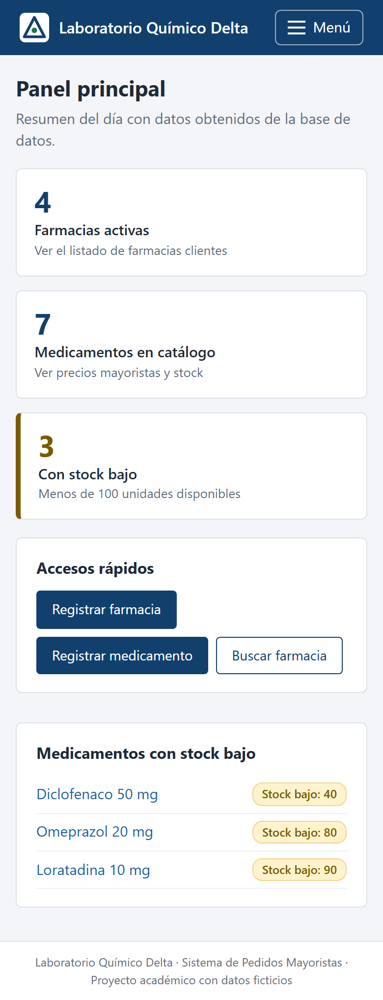
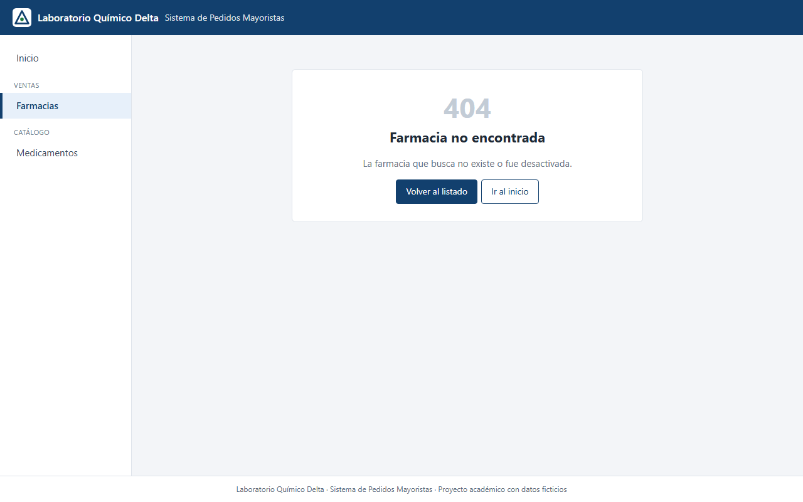
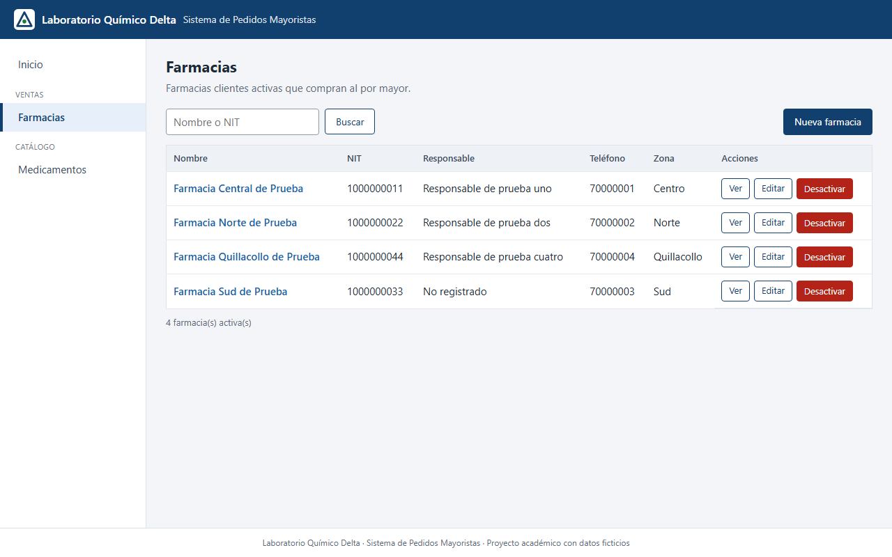
