# 1. Introducción

Esta cuarta entrega toma la aplicación web que construimos en las actividades anteriores y la somete a un plan de pruebas formal antes de ponerla a disposición en un entorno accesible desde Internet. Hasta ahora cada módulo se había probado mientras se desarrollaba; aquí ordenamos esas comprobaciones, agregamos pruebas nuevas, buscamos errores a propósito, corregimos lo que encontramos y verificamos que el sistema funcione igual una vez desplegado.

El documento sigue el orden del contenido mínimo de la actividad: primero describe el sistema y los objetivos de las pruebas, después presenta el diseño y la ejecución de los casos funcionales y de integración, el registro y la corrección de errores, y por último la preparación del entorno, el despliegue y su verificación.

# 2. Desarrollo de contenido

## 2.1 Descripción general del sistema

El Sistema de Pedidos Mayoristas de Laboratorio Químico Delta es una aplicación web para una empresa ficticia que fabrica medicamentos y los vende al por mayor a farmacias. En su estado actual permite administrar las farmacias clientes y el catálogo de medicamentos: registrar, listar, buscar, ver el detalle, editar y desactivar registros, con un panel de inicio que resume los datos de la base.

La aplicación sigue el patrón MVC sobre Node.js con Express. Las vistas se generan en el servidor con EJS, los controladores reciben las solicitudes y validan los datos, y los modelos son la única parte que consulta MySQL 8.4, siempre con consultas parametrizadas. Las bajas son lógicas (columna activo) para no perder el historial que más adelante tendrán los pedidos.

## 2.2 Objetivos del plan de pruebas

El objetivo general es comprobar que las funcionalidades implementadas hacen lo que dicen los requerimientos, tanto en el equipo de desarrollo como en el entorno desplegado, y dejar evidencia de cada resultado.

Los objetivos específicos fueron verificar que los formularios aceptan datos válidos y rechazan los inválidos con un mensaje claro; comprobar que los datos rechazados nunca llegan a la base; confirmar que las capas del sistema (vista, controlador, modelo y base de datos) se comunican bien entre sí; buscar errores en casos límite que el uso normal no muestra; y verificar que la aplicación desplegada responde desde Internet y guarda en la misma base de datos.

## 2.3 Identificación de funcionalidades a evaluar

| Módulo | Funcionalidad | Requerimiento relacionado |
|---|---|---|
| Panel | Resumen de farmacias y medicamentos activos | RF de consulta general |
| Farmacias | Registrar, listar, editar y desactivar | RF de gestión de farmacias |
| Farmacias | Validación de NIT, teléfono, zona y NIT único | Reglas de negocio de clientes |
| Medicamentos | Registrar y listar con su categoría | RF de gestión del catálogo |
| Medicamentos | Validación de precio mayor que cero y stock no negativo | Reglas de negocio del catálogo |
| Seguridad | Escape de HTML y rutas inválidas sin error 500 | RNF de seguridad |
| Despliegue | Acceso por HTTPS desde Internet | RNF de disponibilidad |

Quedan fuera de este plan el inicio de sesión, los usuarios y los pedidos, porque todavía no están implementados; figuran como pendientes en la trazabilidad desde la Actividad 3.

## 2.4 Diseño de casos de prueba

Cada caso tiene un identificador, la acción que se realiza, el resultado esperado y el criterio para darlo por correcto. Separamos dos grupos. Las pruebas funcionales (PF) revisan una funcionalidad desde afuera: se envía una solicitud igual a la que hace el navegador y se revisa el código de respuesta y el mensaje que ve el usuario. Las pruebas de integración (PI) revisan que varias partes trabajen juntas, por eso además de la respuesta consultan directamente la base de datos para confirmar lo que se guardó o lo que no.

Para los datos usamos la técnica de particiones de equivalencia y valores límite: un caso válido por formulario y casos inválidos representativos (NIT con letras, zona fuera de la lista, precio cero, stock negativo, identificador no numérico). Los datos son ficticios y llevan un sufijo numérico distinto en cada ejecución para que las pruebas se puedan repetir sin chocar con el NIT único.

Las pruebas están automatizadas en el script pruebas/pruebas-act4.cjs. Usa fetch de Node.js para las solicitudes HTTP, el cliente mysql para revisar la base y Playwright con Chromium para las capturas del sistema desplegado. Elegimos automatizar en lugar de usar Postman porque así el mismo plan se vuelve a ejecutar completo después de cada corrección (prueba de regresión) en menos de un minuto.

## 2.5 Ejecución de pruebas funcionales

Las pruebas se ejecutaron el 23 de noviembre de 2026 contra el servidor local (http://localhost:3000) con la base delta_pedidos. La tabla muestra la ejecución final, después de corregir el error ERR-01.

| ID | Caso | Resultado esperado | Resultado obtenido | Estado |
|---|---|---|---|---|
| PF-01 | Abrir el panel principal | 200 y panel visible | 200 | Correcto |
| PF-02 | Listar farmacias | 200 con tabla de farmacias | 200 | Correcto |
| PF-03 | Registrar farmacia con datos válidos | Redirección a /farmacias?ok=registrada | 302 /farmacias?ok=registrada | Correcto |
| PF-04 | Registrar farmacia con NIT no numérico | Formulario con error del NIT, sin guardar | 422, mensaje: sí | Correcto |
| PF-05 | Registrar farmacia con NIT repetido | Mensaje de NIT ya registrado | 409 | Correcto |
| PF-06 | Registrar farmacia con zona fuera de la lista | Error de zona no válida | 422 | Correcto |
| PF-07 | Editar teléfono de la farmacia | Redirección con ok=actualizada | 302 /farmacias/21?ok=actualizada | Correcto |
| PF-08 | Registrar medicamento válido | Redirección con ok | 302 /medicamentos?ok=registrado | Correcto |
| PF-09 | Registrar medicamento con stock negativo | Error de stock | 422 | Correcto |
| PF-10 | Registrar medicamento con precio cero | Error de precio | 422 | Correcto |
| PF-11 | Abrir una ruta inexistente | Página 404 | 404 | Correcto |
| PF-12 | Abrir farmacia con id no numérico | Página 404, sin error 500 | 404 | Correcto |
| PF-13 | Nombre con etiqueta &lt;script> (inyección HTML) | Se muestra como texto escapado | escapado | Correcto |
| PF-14 | Registrar de nuevo el NIT de una farmacia desactivada (regresión ERR-01) | Se reactiva con los datos nuevos (ok=reactivada) | 302 /farmacias?ok=reactivada; Farmacia Reabierta 2682276, activo=1 | Correcto |

Las capturas muestran cómo ve el usuario dos de los casos de rechazo. Para que la prueba llegue al servidor desactivamos antes la validación del navegador; así comprobamos que, aunque alguien la salte, el servidor no guarda el dato y marca el campo con el error.

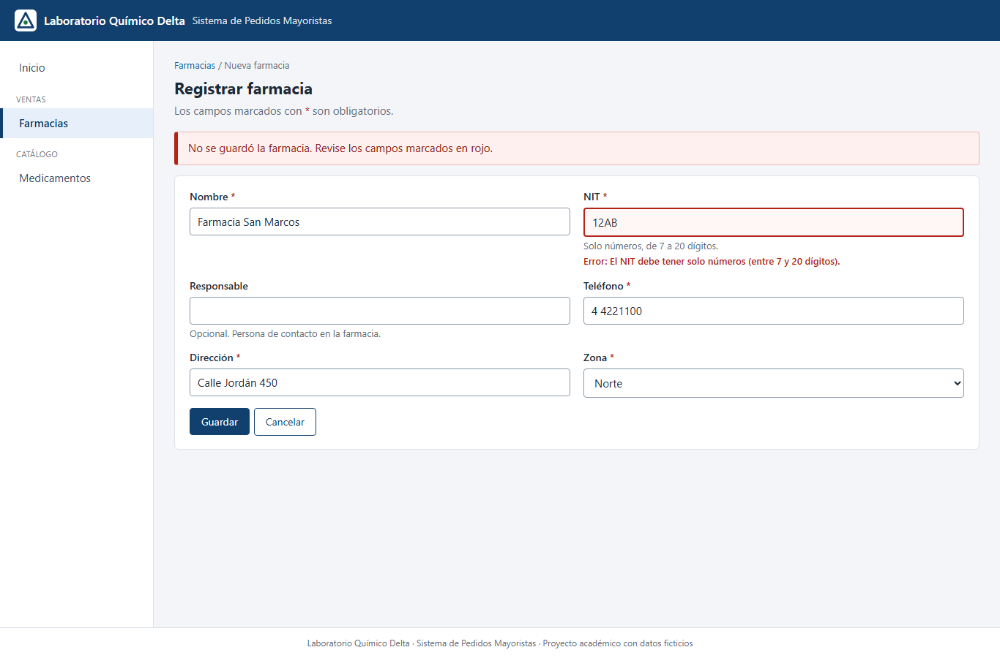
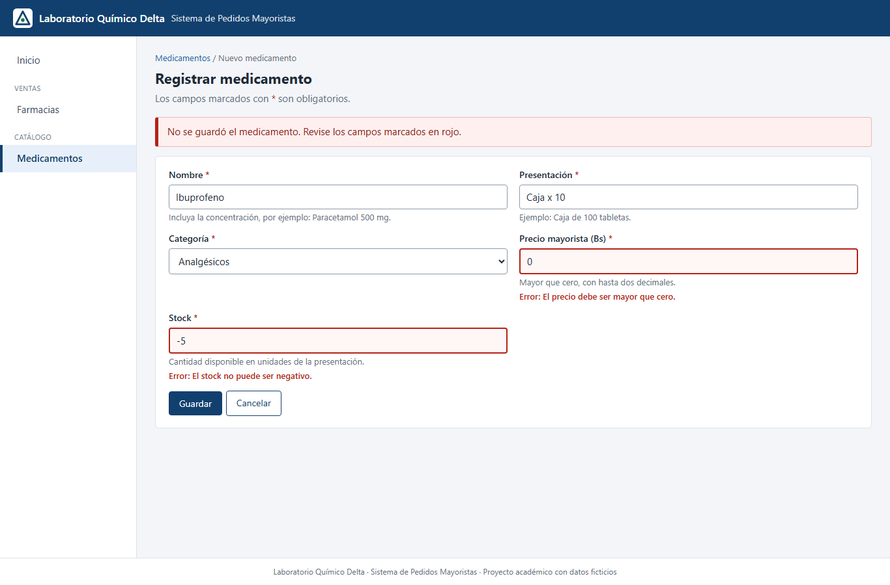

## 2.6 Pruebas de integración

Los casos PI-01 a PI-04 recorren el camino completo dentro del servidor: el formulario envía los datos, el controlador los valida, el modelo ejecuta la consulta y la fila queda en MySQL. Los casos PI-05 y PI-06 se ejecutaron contra la URL pública y prueban la integración entre el túnel HTTPS, el servidor y la base: un registro hecho desde Internet aparece en la base local.

| ID | Caso | Resultado esperado | Resultado obtenido | Estado |
|---|---|---|---|---|
| PI-01 | Formulario, controlador, modelo y MySQL guardan la farmacia | Fila con Farmacia Prueba 2682276, 4 4259999, Centro, 1 | Farmacia Prueba 2682276, 4 4259999, Centro, 1 | Correcto |
| PI-02 | Los datos rechazados no llegan a la base | 0 filas | 0 filas | Correcto |
| PI-03 | Desactivar farmacia (borrado lógico) y que salga del listado | activo = 0 y no aparece | activo = 0, en listado: no | Correcto |
| PI-04 | Listado de medicamentos une medicamento y categoría | Muestra Paracetamol Prueba 2682276 con Analgésicos | sí | Correcto |
| PI-05 | Sistema desplegado responde por HTTPS desde Internet | 200 | 200 | Correcto |
| PI-06 | Registro hecho en la URL pública llega a MySQL | 302 y 1 fila en la base | 302, 1 fila | Correcto |

## 2.7 Registro de errores encontrados

La primera ejecución dio 19 de 19 casos correctos. Como un plan que no encuentra nada no dice mucho, seguimos con pruebas exploratorias sobre casos límite: identificadores como 16abc, 1.5, -1 o un número de veinte dígitos, categorías inexistentes, formularios vacíos, edición y desactivación de registros ya desactivados. Todos devolvieron el código correcto (404 o 422) sin errores 500. El único problema apareció al combinar dos funcionalidades que por separado estaban bien.

| ID | Descripción | Pasos para reproducir | Severidad | Estado |
|---|---|---|---|---|
| ERR-01 | No se puede volver a registrar una farmacia que fue desactivada. El sistema responde "Ya existe una farmacia registrada con este NIT", pero esa farmacia no aparece en el listado ni se puede editar, así que el NIT queda bloqueado para siempre. | Desactivar una farmacia y registrar otra con el mismo NIT. | Media | Corregido |
| ERR-02 | Al detener MySQL mientras se usaba el sistema, algunas solicitudes mostraban el error 500 en vez de la página "sin conexión" (código ER_SERVER_SHUTDOWN). | Detener MySQL con el sistema abierto y enviar un formulario. | Baja | Corregido en la Actividad 3 (registrado aquí como antecedente) |

El ERR-01 viene de una decisión del diseño: el NIT es único en la tabla aunque la farmacia esté inactiva, lo cual es correcto porque un NIT identifica a un solo contribuyente, pero el controlador no tenía en cuenta que el registro repetido podía ser el de un cliente que vuelve.

## 2.8 Corrección de errores y evidencias

Para ERR-01 evaluamos dos opciones: quitar la restricción UNIQUE o reactivar la farmacia existente. Quitarla permitiría dos filas con el mismo NIT y rompería la relación con los pedidos antiguos, así que elegimos reactivar. Agregamos al modelo la función reactivarPorNit, que actualiza los datos y pone activo en 1 solo si existe una farmacia inactiva con ese NIT. En el controlador, cuando MySQL devuelve ER_DUP_ENTRY, primero se intenta esa reactivación; si no había una farmacia inactiva, se muestra el mensaje de NIT repetido como antes.

```js
// farmaciaController.js, acción crear
if (err.code === 'ER_DUP_ENTRY') {
  if (await Farmacia.reactivarPorNit(datos)) return res.redirect('/farmacias?ok=reactivada');
  return mostrarFormulario(res, { ..., errores: { nit: 'Ya existe una farmacia registrada con este NIT.' } });
}
```

Después de la corrección agregamos el caso PF-14 al plan y volvimos a ejecutar todas las pruebas: 20 de 20 correctas, con lo que se comprueba que el arreglo funciona y que no rompió nada más (el caso PF-05, NIT repetido de una farmacia activa, sigue dando el error esperado).

Para dejar evidencia del antes y el después, levantamos la versión anterior del código (commit 9665bed) en el puerto 3001 e hicimos el mismo registro en las dos versiones, con el NIT de una farmacia que el plan había desactivado.

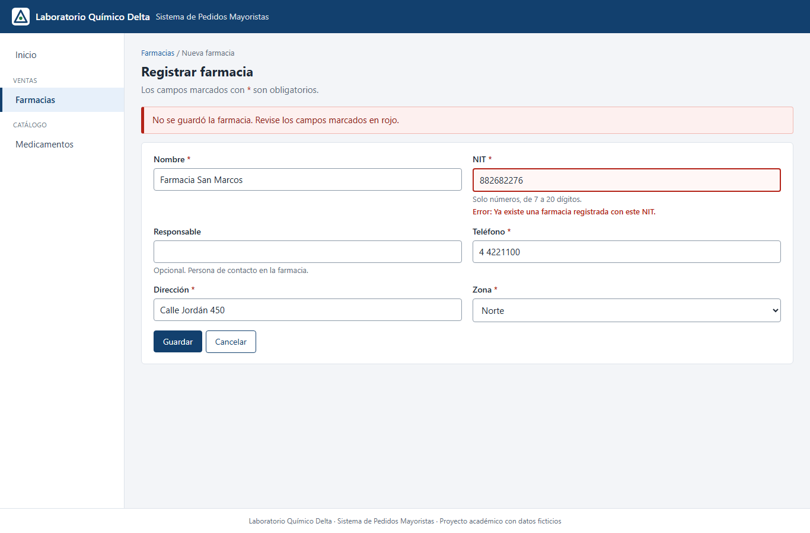
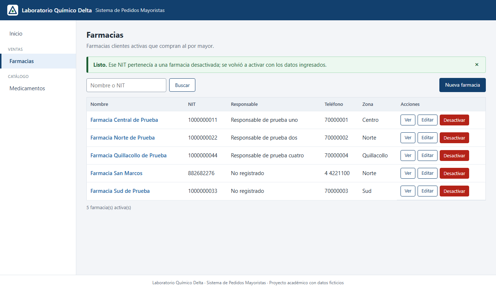

## 2.9 Preparación del entorno de despliegue

La aplicación necesita Node.js y un servidor MySQL. Las plataformas en la nube con plan gratuito (Render, Railway) exigen además una base MySQL alojada aparte y cuentas configuradas, y en la mayoría el plan gratuito apaga el servicio cuando no recibe visitas. Para la demostración optamos por publicar el servidor del equipo de desarrollo mediante un túnel de Cloudflare (Cloudflare Tunnel), que entrega una dirección HTTPS pública sin abrir puertos del router ni exponer la base de datos: solo el puerto 3000 de la aplicación sale a Internet, y MySQL sigue escuchando únicamente en 127.0.0.1.

La preparación consistió en los siguientes pasos:

1. Iniciar MySQL 8.4 con su archivo de configuración (my.ini) y comprobar la conexión con la base delta_pedidos.
2. Revisar que las credenciales estén en el archivo .env, que está en .gitignore y nunca se sube a GitHub.
3. Instalar las dependencias con npm install e iniciar la aplicación con npm start.
4. Ejecutar el plan de pruebas en local antes de publicar.

El archivo iniciar-sistema.bat automatiza el arranque de MySQL y de la aplicación en el equipo.

## 2.10 Despliegue de la aplicación web

Con la aplicación corriendo, iniciamos el túnel con el siguiente comando:

```
npx cloudflared tunnel --url http://localhost:3000
```

Cloudflared se conecta a la red de Cloudflare y asigna una dirección pública con certificado HTTPS. La dirección obtenida para esta entrega fue https://bedroom-try-amendment-matching.trycloudflare.com. Este es el registro de cloudflared al iniciar el túnel:

```
2026-11-23T14:01:49Z INF Requesting new quick Tunnel on trycloudflare.com...
2026-11-23T14:01:55Z INF |  https://bedroom-try-amendment-matching.trycloudflare.com  |
2026-11-23T14:01:56Z INF Registered tunnel connection connIndex=0 location=lpb01 protocol=quic
```

La conexión quedó registrada en el nodo lpb01 de Cloudflare (La Paz), el más cercano. El túnel rápido cambia de dirección cada vez que se inicia y solo está disponible mientras el equipo está encendido, por lo que para la defensa se vuelve a levantar con el mismo comando. Para las actividades 5 y 6 la idea es pasar a un servicio en la nube con la base alojada, aprovechando que la configuración ya se lee desde variables de entorno (PORT y los datos de conexión).

## 2.11 Verificación del sistema desplegado

Verificamos el despliegue de dos formas. Primero con los casos PI-05 y PI-06, que se ejecutaron contra la URL pública: la página principal respondió 200 por HTTPS y una farmacia registrada desde Internet quedó guardada en la base. Después abrimos las pantallas principales desde la URL pública con un navegador, en escritorio y en el ancho de un celular.

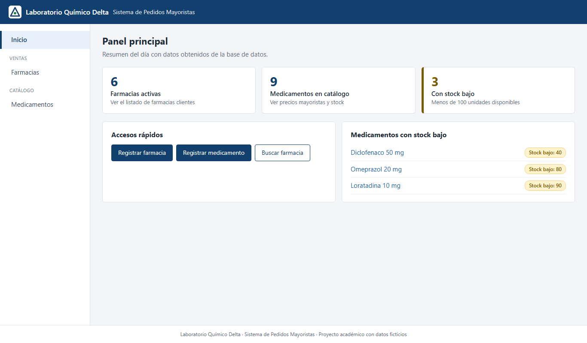
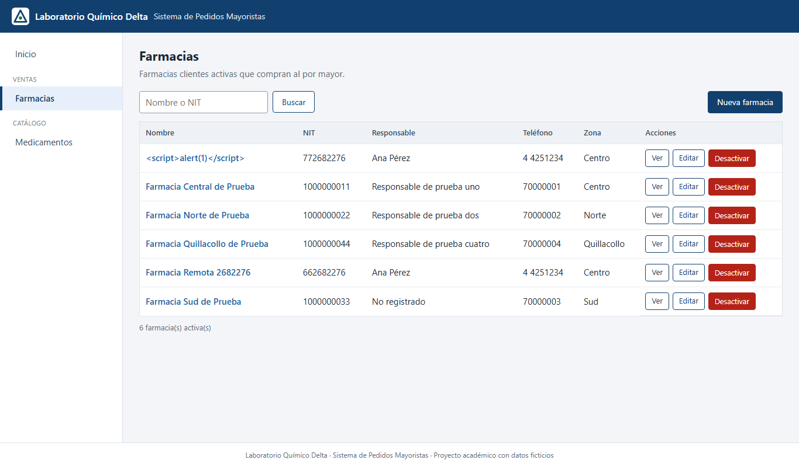
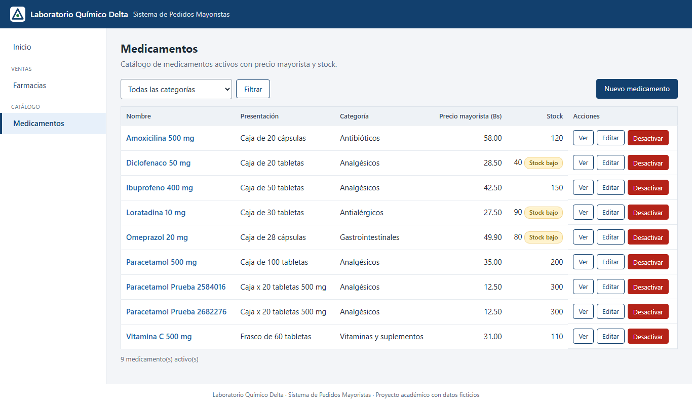
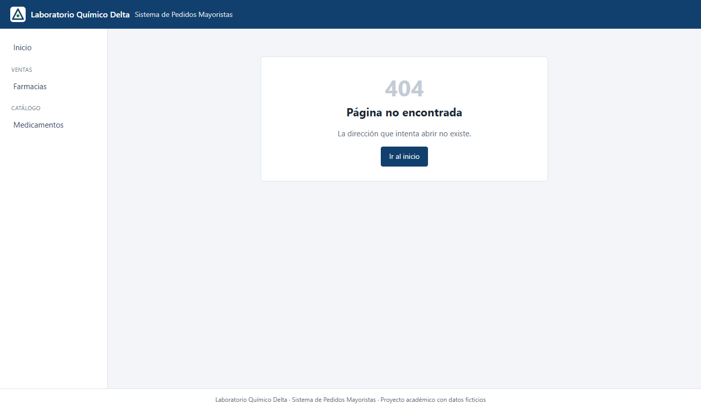
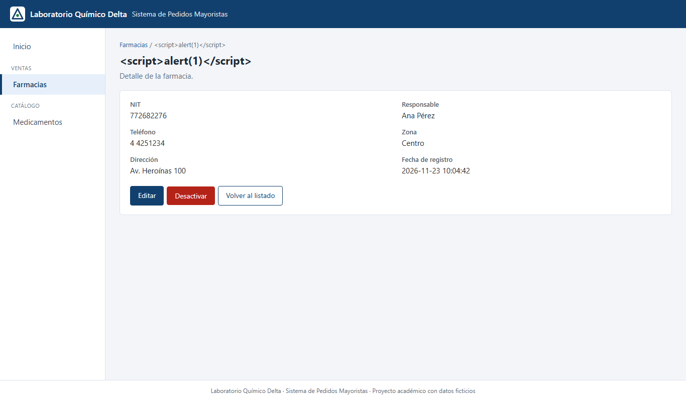
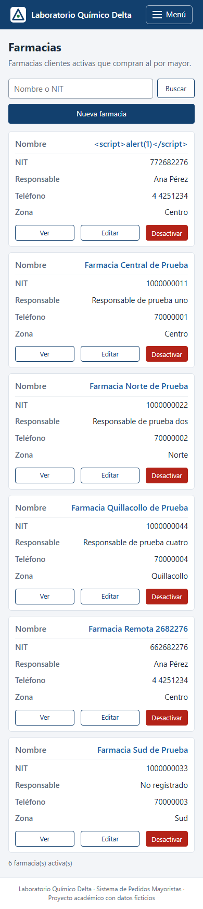

## 2.12 Informe de resultados de las pruebas

| Tipo de prueba | Casos | Correctos | Fallidos |
|---|---|---|---|
| Funcionales | 14 | 14 | 0 |
| Integración | 6 | 6 | 0 |
| Total | 20 | 20 | 0 |

En la primera ejecución pasaron los 19 casos diseñados al inicio. Las pruebas exploratorias encontraron un error de severidad media (ERR-01), que se corrigió y quedó cubierto por un caso de regresión nuevo. La ejecución final da 20 de 20 correctos en local y en el entorno desplegado. Las validaciones del servidor, el NIT único, la baja lógica, el escape de HTML y el manejo de rutas inválidas funcionan como se diseñaron. Lo que todavía no se puede probar es el flujo de pedidos y el control de acceso, que se implementarán en las próximas actividades.

## 2.13 Repositorio GitHub actualizado

El repositorio https://github.com/GustavoRodVe/sistema-pedidos-delta se actualizó con la corrección del ERR-01, el script de pruebas (pruebas/pruebas-act4.cjs), los resultados en formato JSON, las capturas de esta actividad (evidencias/actividad-4) y este documento (documentacion/actividad-4). El archivo .env con las credenciales no forma parte del repositorio.

| Commit | Descripción |
| --- | --- |
| 9665bed | Agrega al documento de la Actividad 3 las capturas del repositorio en GitHub |
| 1d040b8 | Reactiva la farmacia desactivada al registrar de nuevo su NIT y agrega el plan de pruebas de la Actividad 4 |

Después de subir los cambios revisamos en GitHub que aparecieran la carpeta pruebas, las evidencias y el cambio en el controlador y el modelo de farmacias.

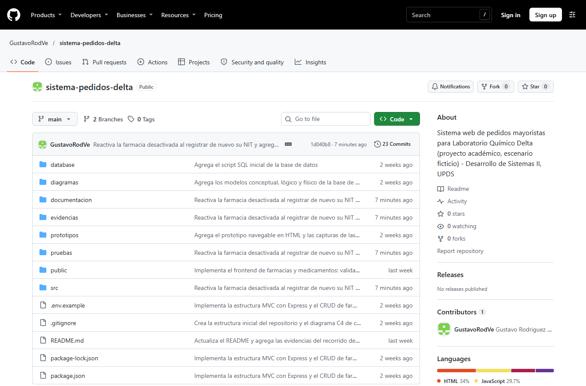
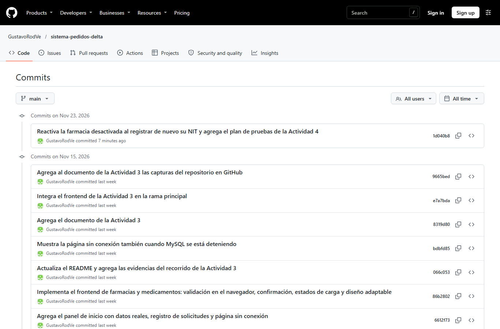
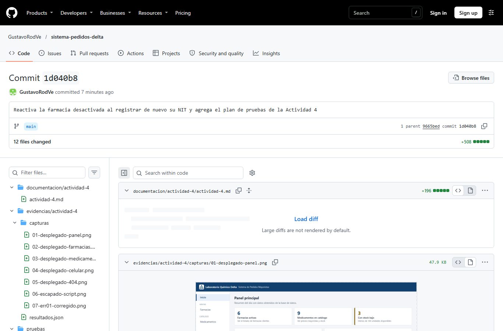

# 3. Conclusiones

El plan de pruebas confirmó que los módulos de farmacias y medicamentos cumplen sus requerimientos y que los datos inválidos no llegan a la base. Lo más útil no fue la primera ejecución, que salió completa, sino las pruebas exploratorias: el ERR-01 solo aparece al combinar la baja lógica con el NIT único, y un usuario real lo habría encontrado en cuanto un cliente volviera a comprar.

Automatizar el plan valió la pena. Después de corregir el error volvimos a correr los veinte casos en menos de un minuto y comprobamos que el arreglo no rompió nada. El despliegue con Cloudflare Tunnel resolvió la demostración sin costo y sin exponer la base, aunque depende de que el equipo esté encendido; para el producto final hace falta un alojamiento permanente.

# 4. Anexos

## Anexo A. Salida de la ejecución final del plan

```
PF-01 OK    Abrir el panel principal -> 200
PF-02 OK    Listar farmacias -> 200
PF-03 OK    Registrar farmacia con datos válidos -> 302 /farmacias?ok=registrada
PF-04 OK    Registrar farmacia con NIT no numérico -> 422, mensaje: sí
PF-05 OK    Registrar farmacia con NIT repetido -> 409
PF-06 OK    Registrar farmacia con zona fuera de la lista -> 422
PF-07 OK    Editar teléfono de la farmacia -> 302 /farmacias/21?ok=actualizada
PF-08 OK    Registrar medicamento válido -> 302 /medicamentos?ok=registrado
PF-09 OK    Registrar medicamento con stock negativo -> 422
PF-10 OK    Registrar medicamento con precio cero -> 422
PF-11 OK    Abrir una ruta inexistente -> 404
PF-12 OK    Abrir farmacia con id no numérico -> 404
PF-13 OK    Nombre con etiqueta <script> (inyección HTML) -> escapado
PI-01 OK    Formulario, controlador, modelo y MySQL guardan la farmacia -> Farmacia Prueba 2682276, 4 4259999, Centro, 1
PI-02 OK    Los datos rechazados no llegan a la base -> 0 filas
PI-03 OK    Desactivar farmacia (borrado lógico) y que salga del listado -> activo = 0, en listado: no
PF-14 OK    Registrar de nuevo el NIT de una farmacia desactivada (regresión ERR-01) -> 302 /farmacias?ok=reactivada; Farmacia Reabierta 2682276, activo=1
PI-04 OK    Listado de medicamentos une medicamento y categoría -> sí
PI-05 OK    Sistema desplegado responde por HTTPS desde Internet -> 200
PI-06 OK    Registro hecho en la URL pública llega a MySQL -> 302, 1 fila

20/20 correctas
```

## Anexo B. Comandos para repetir las pruebas

```
# 1. Iniciar MySQL y la aplicación
iniciar-sistema.bat
# 2. Publicar la aplicación
npx cloudflared tunnel --url http://localhost:3000
# 3. Ejecutar el plan contra la URL que entregó cloudflared
node pruebas/pruebas-act4.cjs https://<direccion>.trycloudflare.com
```
